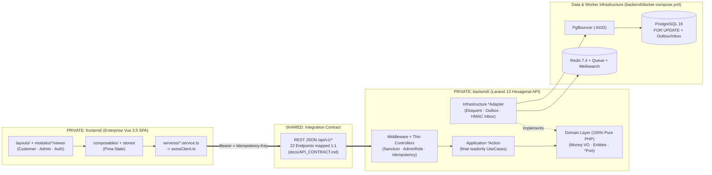
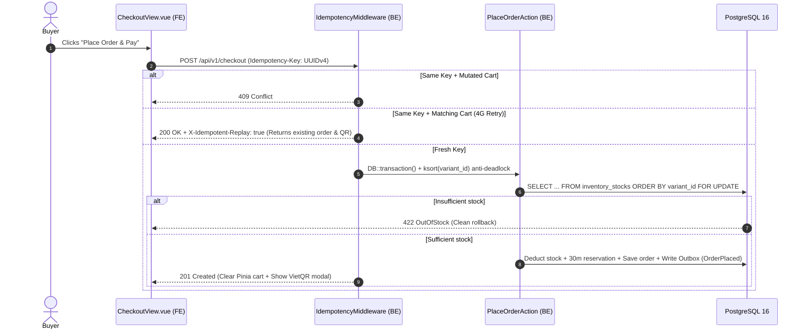
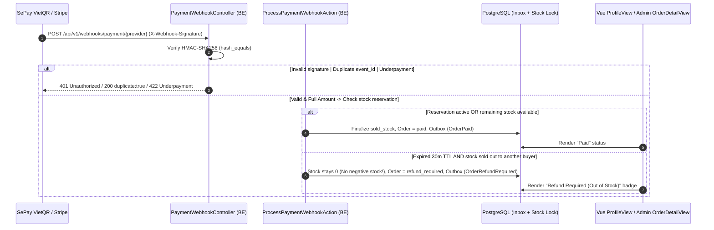

# CleanCommerce — Laravel 13 Hexagonal Clean Architecture API + Enterprise Vue 3.5 SPA  
*(Hệ Thống Thương Mại Điện Tử CleanCommerce — Laravel 13 Hexagonal API + Enterprise Vue 3.5 SPA)*

An enterprise e-commerce architecture organized around **"Private where independence matters, Shared where integration matters (`0%` duplication)"**:  
*(Kiến trúc thương mại điện tử tổ chức chặt chẽ theo nguyên tắc **"Cái nào cần riêng thì riêng, cái nào cần chung thì chung (`0%` trùng lặp)"**:)*

1. **PRIVATE SERVICES (`backend/` & `frontend/` — 100% Autonomous, Polyrepo-Ready)**:  
   *(**PHẦN RIÊNG (`backend/` & `frontend/` — Tự chủ 100%, Polyrepo-Ready)**:)*

   - Each service owns its complete `.env.example`, `Dockerfile`, `docker-compose.yml`, and internal domain documentation (`backend/docs/LAW.md` & `MODULE_MAP.md`; `frontend/docs/DESIGN.md`).  
     *(Mỗi thư mục tự sở hữu trọn bộ `.env.example`, `Dockerfile`, `docker-compose.yml` và tài liệu nội bộ chuyên môn của riêng mình (`backend/docs/LAW.md` & `MODULE_MAP.md`; `frontend/docs/DESIGN.md`).)*

   - `backend/` is a 100% pure JSON REST API (`0` `vite.config.js`, `0` `package.json`); `frontend/` follows the layered Enterprise Vue 3 standard (`assets`, `components`, `composables`, `layouts`, `modules`, `router`, `services`, `stores`, `types`, `utils`).  
     *(`backend/` thuần 100% JSON REST API (`0` `vite.config.js`, `0` `package.json`); `frontend/` phân tầng chuẩn Enterprise Vue 3 (`assets`, `components`, `composables`, `layouts`, `modules`, `router`, `services`, `stores`, `types`, `utils`).)*

2. **SHARED ROOT (`compose.yaml` & `docs/` at root — 1:1 End-to-End Visibility)**:  
   *(**PHẦN CHUNG (`compose.yaml` & `docs/` tại gốc — Nhìn thấu toàn hệ thống khớp nhau 1:1)**:)*

   - `compose.yaml` (Docker Compose v2.20+ `include:`) boots all **9 containers with a single command** over the `cleancommerce-shared-net` bridge network without duplicating a single line of YAML.  
     *(`compose.yaml` (chuẩn Docker Compose v2.20+ `include:`) gộp chạy toàn bộ **9 containers chỉ bằng 1 câu lệnh** trên mạng cầu `cleancommerce-shared-net` mà không lặp lại một dòng cấu hình nào.)*

   - `docs/API_CONTRACT.md` & `docs/ARCHITECTURE.md` act as the **Single Source of Truth**, mapping every Frontend Vue view and `Axios Service` method 1:1 to its exact Backend `Route -> Controller -> UseCase Action -> Domain Port -> PostgreSQL` table.  
     *(`docs/API_CONTRACT.md` & `docs/ARCHITECTURE.md` là **Nguồn sự thật duy nhất** ánh xạ 1:1 từng màn hình/hàm `Axios Service` bên Frontend sang đúng `Route -> Controller -> UseCase Action -> Domain Port -> PostgreSQL` bên Backend.)*

---

## 1. Directory Topology (`SHARED` vs `PRIVATE`)  
*(Cấu Trúc Thư Mục Phân Định Rõ `CHUNG` vs `RIÊNG`)*

```text
VueLaravelProject/
├── compose.yaml                     # [SHARED] Docker Compose v2 `include:` bridging backend + frontend (0 YAML duplication)
├── AGENTS.md / CLAUDE.md            # [SHARED] Workspace router for AI Agents (Antigravity, Claude Code, Codex)
├── README.md                        # [SHARED] System overview & launch guide
├── docs/                            # [SHARED] Cross-domain integration specs (Single Source of Truth)
│   ├── LAW.md                       #   ├─ System-level engineering constitution & hygiene invariants
│   ├── ARCHITECTURE.md              #   ├─ End-to-end FE <-> API <-> BE <-> DB diagrams & 6 Cloud scars
│   ├── API_CONTRACT.md              #   ├─ 1:1 matrix of all 22 Endpoints (Vue View <-> Axios <-> Laravel Action)
│   └── WBS.md                       #   └─ Master scope & Full-Stack acceptance gates
│
├── backend/                         # [PRIVATE] Laravel 13 Pure Headless API service (0 vite.config.js)
│   ├── .env.example & Dockerfile & docker-compose.yml (8 standalone containers)
│   ├── AGENTS.md / CLAUDE.md & README.md
│   ├── docs/                        #   ├─ Internal PHP/Hexagonal documentation:
│   │   ├── LAW.md                   #   │  4-ring Pure PHP laws, Money BIGINT, ksort + FOR UPDATE, Outbox, Pint
│   │   ├── MODULE_MAP.md            #   │  Map of 7 Bounded Contexts, Ports <-> Adapters & outbox:relay
│   │   └── WBS.md                   #   │  Standalone Backend verification gate (`composer lint && composer test`)
│   └── app/{Core/SharedKernel, Modules/7-Bounded-Contexts}
│
└── frontend/                        # [PRIVATE] Enterprise Vue 3.5 + TS + Axios + Pinia + SCSS service
    ├── .env.example & Dockerfile & docker-compose.yml (Standalone SPA container)
    ├── AGENTS.md / CLAUDE.md & README.md
    ├── docs/                        #   ├─ Internal UI/Frontend documentation:
    │   ├── DESIGN.md                #   │  Calm Daylight 60-30-10 SCSS Tokens, Anti-Slop & `src/` tree standard
    │   └── WBS.md                   #   │  Standalone Frontend verification gate (`npm run build` & `fe-gate.mjs`)
    └── src/{assets, components, composables, layouts, modules, router, services, stores, types, utils}
```

### Quick Documentation Index  
*(Danh Mục Tài Liệu Đọc Nhanh)*

- **Full-Stack Integration (`SHARED`)**: [docs/LAW.md](./docs/LAW.md) · [docs/ARCHITECTURE.md](./docs/ARCHITECTURE.md) · [docs/API_CONTRACT.md](./docs/API_CONTRACT.md) · [docs/WBS.md](./docs/WBS.md)  
  *(**Tích hợp Toàn hệ thống (`PHẦN CHUNG`)**: [docs/LAW.md](./docs/LAW.md) · [docs/ARCHITECTURE.md](./docs/ARCHITECTURE.md) · [docs/API_CONTRACT.md](./docs/API_CONTRACT.md) · [docs/WBS.md](./docs/WBS.md))*

- **Backend Deep Dive (`PRIVATE`)**: [backend/docs/LAW.md](./backend/docs/LAW.md) · [backend/docs/MODULE_MAP.md](./backend/docs/MODULE_MAP.md) · [backend/docs/WBS.md](./backend/docs/WBS.md)  
  *(**Chuyên sâu nội bộ Backend (`PHẦN RIÊNG`)**: [backend/docs/LAW.md](./backend/docs/LAW.md) · [backend/docs/MODULE_MAP.md](./backend/docs/MODULE_MAP.md) · [backend/docs/WBS.md](./backend/docs/WBS.md))*

- **Frontend Deep Dive (`PRIVATE`)**: [frontend/docs/DESIGN.md](./frontend/docs/DESIGN.md) · [frontend/docs/WBS.md](./frontend/docs/WBS.md)  
  *(**Chuyên sâu nội bộ Frontend (`PHẦN RIÊNG`)**: [frontend/docs/DESIGN.md](./frontend/docs/DESIGN.md) · [frontend/docs/WBS.md](./frontend/docs/WBS.md))*

---

## 2. End-to-End System Matching (`Frontend <-> API Contract <-> Backend <-> Infra`)  
*(Sơ Đồ Khớp Nối Đầu-Cuối Toàn Hệ Thống (`Frontend <-> API Contract <-> Backend <-> Infra`))*



---

## 3. Core Cross-Domain Transaction Flows & High-Load Resilience  
*(Hai Luồng Giao Dịch Xuyên Miền & Chống Sập Thực Chiến)*

### 3.1 Cross-Domain Checkout (`Vue CheckoutView -> Idempotency -> Sorted Lock FOR UPDATE -> Outbox`)  
*(Đặt Hàng Xuyên Miền (`Vue CheckoutView -> Idempotency -> Sorted Lock FOR UPDATE -> Outbox`))*



### 3.2 HMAC Bank Webhook, Inbox Deduplication & Late-Transfer Protection  
*(Webhook Ngân Hàng HMAC, Chống Trùng Inbox & Xử Lý Chuyển Khoản Trễ Quá Hạn Giữ Chỗ)*



---

## 4. Three Flexible Launch Modes (`Shared` or `Standalone`)  
*(Ba Chế Độ Khởi Chạy Linh Hoạt (`Chung` hoặc `Riêng`))*

### Mode 1 — Boot Full 9-Container Stack from Root (`compose.yaml`)  
*(Chế độ 1 — Bật Chung Toàn Hệ Thống 9 Containers Từ Gốc (`compose.yaml`))*

```bash
docker compose up -d --build
docker compose exec api php artisan migrate --seed --force
```

- **Frontend SPA (`Storefront` + `Admin`)**: `http://localhost:5173`  
  *(**Giao diện Frontend (`Storefront` + `Admin`)**: `http://localhost:5173`)*

- **Headless REST API**: `http://localhost:8080/api/v1/health` · **Mailpit**: `http://localhost:8025` · **Meilisearch**: `http://localhost:7700`  
  *(**Headless REST API**: `http://localhost:8080/api/v1/health` · **Mailpit**: `http://localhost:8025` · **Meilisearch**: `http://localhost:7700`)*

### Mode 2 — Boot Each Service Standalone (Split Teams / Split Repos)  
*(Chế độ 2 — Bật Riêng Từng Dịch Vụ Khi Tách Team / Tách Repo)*

```bash
# Backend team runs their standalone 8-container cluster:
cd backend && cp -n .env.example .env && docker compose up -d --build

# Frontend team runs their standalone SPA container:
cd frontend && cp -n .env.example .env && docker compose up -d --build
```

### Mode 3 — Fast Local Development Without Docker  
*(Chế độ 3 — Phát Triển Nhanh Trên Máy Local Không Cần Docker)*

```bash
# Terminal 1 (Backend API + SQLite):
cd backend && composer lint && composer test && php artisan migrate:fresh --seed && php artisan serve --port=8080

# Terminal 2 (Frontend Vue 3 SPA):
cd frontend && npm run dev
```

### Pre-Seeded Demo Accounts & Coupons  
*(Tài Khoản & Mã Giảm Giá Seed Sẵn)*

- **Administrator (`/admin`)**: `admin@cleancommerce.vn` / `Admin@123456`  
  *(**Quản trị viên (`/admin`)**: `admin@cleancommerce.vn` / `Admin@123456`)*

- **Customer**: `khachhang@cleancommerce.vn` / `Customer@123456`  
  *(**Khách hàng**: `khachhang@cleancommerce.vn` / `Customer@123456` — có nút điền nhanh tại `/auth/login`)*

- **Test Coupons**: `WELCOME10` · `VIP200K` · `FREESHIP`  
  *(**Voucher thử nghiệm**: `WELCOME10` · `VIP200K` · `FREESHIP`)*
