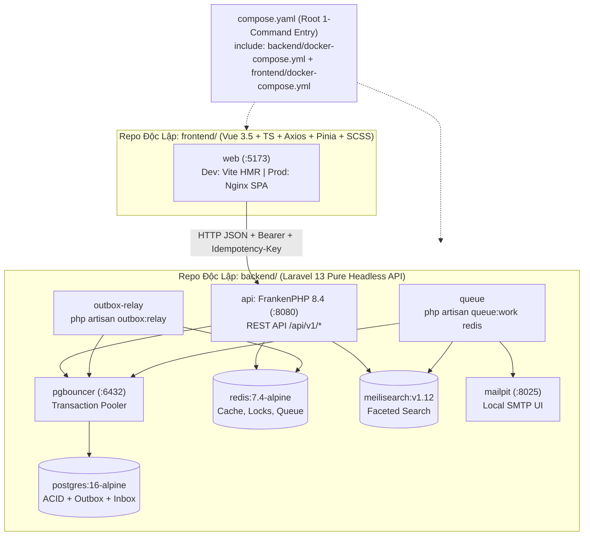
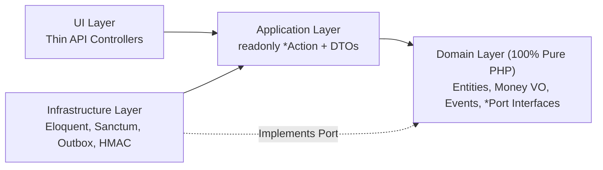
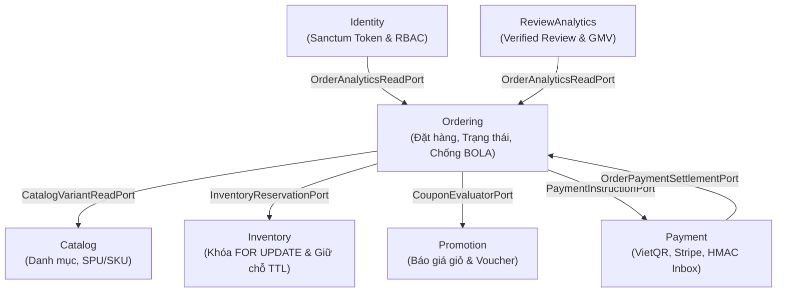
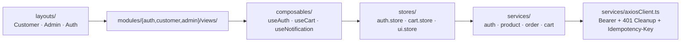
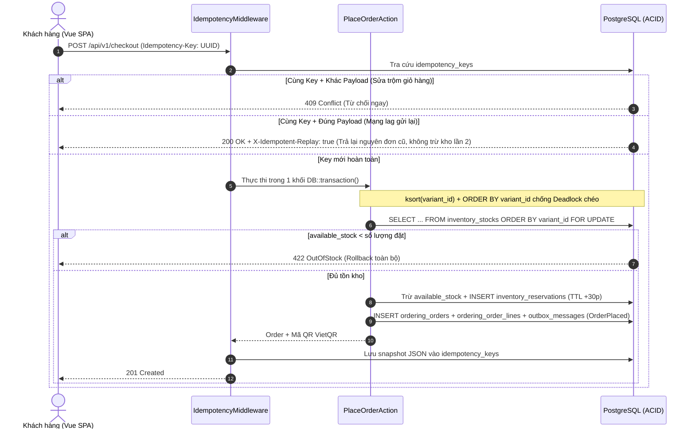
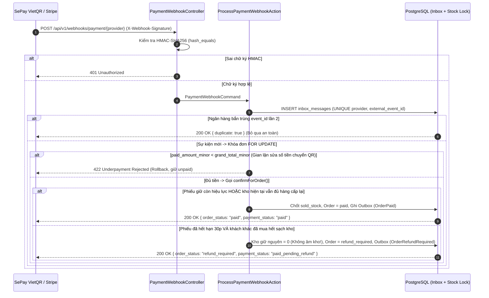

# CleanCommerce — Laravel 13 Hexagonal Clean Architecture API + Enterprise Vue 3.5 SPA

Nền tảng E-Commerce kết hợp trọn vẹn **hai chuẩn mực thực chiến**:
1. **Chuẩn Polyrepo Độc Lập (Team / Tech Lead Standard):** `backend/` và `frontend/` tự chứa đầy đủ `.env.example`, `Dockerfile`, `docker-compose.yml` và `docs/` riêng biệt — sẵn sàng tách thành 2 Git repository độc lập bất kỳ lúc nào mà không vướng file rác; Backend thuần JSON API (`0` `vite.config.js`), Frontend phân tầng chuẩn Enterprise Vue 3 (`assets`, `components`, `composables`, `layouts`, `modules`, `router`, `services/axiosClient`, `stores`, `utils`).
2. **Chuẩn Big Tech PHP & Docker Compose v2 `include:` (Shopify / Stripe Craft):** Tại thư mục gốc, file `compose.yaml` (7 dòng chuẩn Docker Compose v2.20+) nối thẳng `backend/docker-compose.yml` và `frontend/docker-compose.yml` trên mạng cầu chung `cleancommerce-shared-net` — giúp chạy toàn bộ **9 containers chỉ bằng 1 câu lệnh duy nhất** mà không lặp lại một dòng cấu hình nào.

---

## 1. Sơ Đồ Tổng Thể Hạ Tầng Docker `include:` (`9 Self-Contained Containers`)



---

## 2. Kiến Trúc Nội Tại Hai Miền (`Backend Hexagonal DDD` & `Frontend Enterprise Vue 3`)

### 2.1 Backend: 4 Vòng Đồng Tâm & 7 Bounded Contexts (`declare(strict_types=1)` + Pure Domain)





### 2.2 Frontend: Luồng Dữ Liệu Một Chiều Chuẩn Enterprise Vue 3.5



---

## 3. Phân Tích Đầy Đủ Các Luồng Giao Dịch & Tình Huống Biên (`Multi-Flow & Edge Cases`)

### 3.1 Luồng Đặt Hàng Idempotent, Chống Deadlock Đa SKU & Chống Bán Lố Flash Sale



### 3.2 Luồng Webhook HMAC, Chống Trùng Inbox & Bẫy "Chuyển Khoản Trễ Sau Khi Hết Hạn Giữ Chỗ"



---

## 4. Sổ Tay 6 Sự Cố Thực Chiến Cloud & Giải Pháp Kiến Trúc Đã Tích Hợp

| # | Tình huống thực tế gặp phải trên Production | Nguyên nhân gốc (`Root Cause`) | Giải pháp đã tích hợp & kiểm thử tự động |
| :-: | :--- | :--- | :--- |
| **1** | Lỗi `prepared statement "pdo_stmt_..." already exists` khi chạy qua PgBouncer | PgBouncer ở `POOL_MODE=transaction` tráo kết nối vật lý giữa các câu lệnh làm đụng độ PDO prepared statements | Bật `PDO::ATTR_EMULATE_PREPARES => true` cho `pgsql` tại [backend/config/database.php](./backend/config/database.php) |
| **2** | Âm tồn kho (*Phantom Orders*) khi khách quét QR chuyển tiền trễ sau 35 phút | Hết hạn giữ chỗ 30p kho nhả ra cho Khách B mua đứt, nhưng Webhook Khách A đến trễ vẫn đổi thành `paid` | `confirmForOrder()` khóa dòng thử cấp lại; nếu kho = 0 sẽ chuyển sang `refund_required` + phát `OrderRefundRequired` |
| **3** | Gian lận sửa số tiền khi chuyển khoản VietQR | Khách sửa tay số tiền từ `890.000₫` xuống `10.000₫` nhưng giữ nguyên mã `ORD-...` | `settlePaidOrder()` chặn `422` nếu `paidAmountMinor < grand_total_minor` |
| **4** | Treo DB (`Deadlock`) khi 2 giỏ hàng khóa cặp SKU ngược chiều nhau | Request 1 khóa `[SKU_1, SKU_2]`, Request 2 khóa `[SKU_2, SKU_1]` cùng mili-giây | Luôn `ksort` + `ORDER BY variant_id` trước `SELECT ... FOR UPDATE` |
| **5** | Đặt trùng 2 đơn khi mạng 4G lag khách bấm liên tiếp | Client retry `POST /api/v1/checkout` khi chưa nhận response | Header `Idempotency-Key` (UUIDv4) + bảng `idempotency_keys` trả snapshot cũ |
| **6** | Rò rỉ phiên đăng nhập giữa 2 request trên FrankenPHP / Octane | Tiến trình PHP giữ bộ nhớ qua nhiều request | Dùng `final readonly` Actions không biến `static` + `FreshBearerTokenMiddleware` + PHP `Money` số nguyên (`int`, không dùng `float`) |

---

## 5. Cấu Trúc Kho Chứa & Liên Kết Tài Liệu Chi Tiết

```text
VueLaravelProject/
├── compose.yaml                 # Docker Compose v2 `include:` (gộp chạy cả BE + FE bằng 1 lệnh)
├── AGENTS.md / CLAUDE.md        # Điều hướng nhanh cho AI Agents (Claude Code, Codex, Antigravity, Cursor)
├── backend/                     # Repo Độc Lập 1: Laravel 13 Pure Headless API (0 vite.config.js)
│   ├── .env.example & Dockerfile & docker-compose.yml
│   ├── docs/{LAW.md, ARCHITECTURE.md, WBS.md, api/OPENAPI_V1.md}
│   └── app/{Core/SharedKernel, Modules/7-Bounded-Contexts}
└── frontend/                    # Repo Độc Lập 2: Enterprise Vue 3.5 + TS + Axios + Pinia + SCSS
    ├── .env.example & Dockerfile & docker-compose.yml
    ├── docs/{DESIGN.md, ARCHITECTURE.md, WBS.md, api/OPENAPI_V1.md}
    └── src/{assets, components, composables, layouts, modules, router, services, stores, utils}
```

- **Tài liệu chuyên sâu Backend:** [LAW.md](./backend/docs/LAW.md) · [ARCHITECTURE.md](./backend/docs/ARCHITECTURE.md) · [WBS.md](./backend/docs/WBS.md) · [OPENAPI_V1.md](./backend/docs/api/OPENAPI_V1.md)
- **Tài liệu chuyên sâu Frontend:** [DESIGN.md](./frontend/docs/DESIGN.md) · [ARCHITECTURE.md](./frontend/docs/ARCHITECTURE.md) · [WBS.md](./frontend/docs/WBS.md)

---

## 6. Ba Cách Khởi Chạy Linh Hoạt

### Cách 1 — Chạy Full-Stack 9 Containers Từ Thư Mục Gốc (1 Lệnh Duy Nhất Qua `compose.yaml`)
```bash
docker compose up -d --build
docker compose exec api php artisan migrate --seed --force
```
- **Storefront & Admin SPA:** http://localhost:5173
- **Headless REST API:** http://localhost:8080/api/v1/health · **Mailpit:** http://localhost:8025 · **Meilisearch:** http://localhost:7700

### Cách 2 — Chạy Tách Rời Từng Repo Độc Lập (Khi Chia Team BE / FE Riêng)
```bash
# Chỉ bật cụm Backend API + DB + Redis + Queue + Outbox:
cd backend && cp -n .env.example .env && docker compose up -d --build

# Chỉ bật cụm Frontend SPA:
cd frontend && cp -n .env.example .env && docker compose up -d --build
```

### Cách 3 — Chạy Trực Tiếp Trên Máy Local (Không Cần Bật Docker)
```bash
# Terminal 1 (Backend API + SQLite):
cd backend && composer test && php artisan migrate:fresh --seed && php artisan serve --port=8080

# Terminal 2 (Frontend SPA):
cd frontend && npm run dev
```

### Tài Khoản & Voucher Seed Sẵn
- **Admin (`/admin`):** `admin@cleancommerce.vn` / `Admin@123456`
- **Khách hàng:** `khachhang@cleancommerce.vn` / `Customer@123456` *(có nút điền nhanh 1 chạm tại `/auth/login`)*
- **Mã giảm giá:** `WELCOME10` · `VIP200K` · `FREESHIP`
