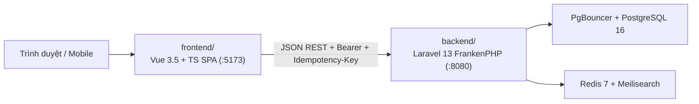

# CleanCommerce — Decoupled Laravel 13 Clean Architecture API + Vue 3.5 SPA

Nền tảng E-Commerce chuẩn **Big Tech Modular Monolith + Hexagonal Clean Architecture**, tách biệt hoàn toàn **Backend (`backend/` — Laravel 13 Headless REST API `/api/v1`)** và **Frontend (`frontend/` — Standalone Vue 3.5 + TypeScript SPA, không dùng Inertia)**, đóng gói tự thân trong **Docker Compose 9 containers**.



---

## 1. Bản Đồ Thư Mục (`Clean Git-Clone Layout`)

Thiết kế chuẩn 3 tầng tài liệu giúp cả **Kỹ sư mới `git clone` về** lẫn **mọi AI Coding Agent** (`Claude Code`, `Cursor`, `Codex`, `Antigravity`) nắm bắt toàn bộ dự án trong 30 giây mà không bị rác file ở thư mục gốc:

```text
Vue Lara/
├── backend/                     # Laravel 13 Headless REST API (7 Hexagonal Bounded Contexts)
│   ├── Dockerfile               # Tự chứa FrankenPHP + PHP OPcache + Caddyfile
│   ├── AGENTS.md                # Chỉ dẫn chuyên biệt cho Agent khi sửa Backend
│   └── app/Modules/             # Identity, Catalog, Inventory, Promotion, Ordering, Payment, ReviewAnalytics
├── frontend/                    # Standalone Vue 3.5 + TypeScript + Pinia + Vue Router 4
│   ├── Dockerfile               # Tự chứa Vite HMR (dev) & Nginx SPA (prod)
│   ├── AGENTS.md                # Chỉ dẫn chuyên biệt cho Agent khi sửa Frontend
│   └── DESIGN.md                # Hệ thống Design Tokens 60-30-10 & Quy chuẩn UI
├── docs/                        # Trung tâm tài liệu kỹ thuật (Không trùng lặp)
│   ├── LAW.md                   # Hiến pháp kiến trúc, Tiền tệ số nguyên, Khóa kho & Bảo mật OWASP
│   ├── ARCHITECTURE.md          # Sơ đồ 9 Docker Containers, 4 vòng Clean Arch & Sequence Đặt hàng
│   ├── WBS.md                   # Phạm vi Spec, Phân rã công việc (WBS) & Lệnh nghiệm thu
│   └── api/OPENAPI_V1.md        # Hợp đồng giao tiếp REST JSON `/api/v1/*` giữa FE và BE
├── AGENTS.md / CLAUDE.md        # Điểm vào điều hướng tự động cho mọi AI Agent
├── Makefile                     # Lệnh tắt vận hành & kiểm thử (`make up`, `make test`)
└── docker-compose.yml           # Điều phối 9 dịch vụ độc lập
```

---

## 2. Khởi Chạy Nhanh Trong 60 Giây

### Cách A — Chạy toàn bộ hạ tầng bằng Docker Compose
```bash
cp -n .env.example .env
make up
```
- **Storefront & Admin SPA:** http://localhost:5173
- **Headless REST API Health:** http://localhost:8080/api/v1/health
- **Meilisearch:** http://localhost:7700 · **Mailpit SMTP UI:** http://localhost:8025

### Cách B — Chạy trực tiếp trên máy Local (Không cần bật Docker Daemon)
```bash
# Terminal 1 — Backend API (:8080, dùng sẵn SQLite đã seed)
cd backend && php artisan migrate:fresh --seed && php artisan serve --port=8080

# Terminal 2 — Frontend SPA (:5173)
cd frontend && npm run dev -- --port=5173
```

---

## 3. Tài Khoản & Mã Khuyến Mãi Mẫu (Seed Sẵn)

| Vai trò | Email | Mật khẩu | Ghi chú |
| :--- | :--- | :--- | :--- |
| **Quản trị Admin (`/admin`)** | `admin@cleancommerce.vn` | `Admin@123456` | Xem GMV, Outbox, tạo SKU, chỉnh tồn kho, duyệt đơn |
| **Khách mua hàng** | `khachhang@cleancommerce.vn` | `Customer@123456` | Có nút điền nhanh 1 chạm ngay tại trang `/login` |

- **Mã giảm giá hoạt động ngay:** `WELCOME10` (Giảm 10%, tối đa 150.000₫) · `VIP200K` (Giảm 200.000₫ đơn từ 1.500.000₫) · `FREESHIP` (Miễn phí vận chuyển).

---

## 4. Kiểm Thử Tự Động (`Exit 0`)
```bash
make test
```
Chạy trọn bộ: Kiểm tra cấu hình Docker Compose + `15` bài test PHPUnit (`ArchitectureBoundaryTest` khóa ranh giới Clean Architecture & `EcommerceCleanArchFlowTest` kiểm thử chống bán lố, `Idempotency-Key`, HMAC Webhook) + Type-check `vue-tsc` & Vite Production Build.
