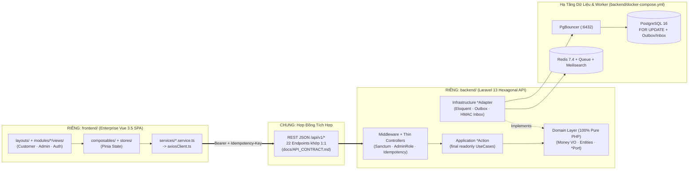
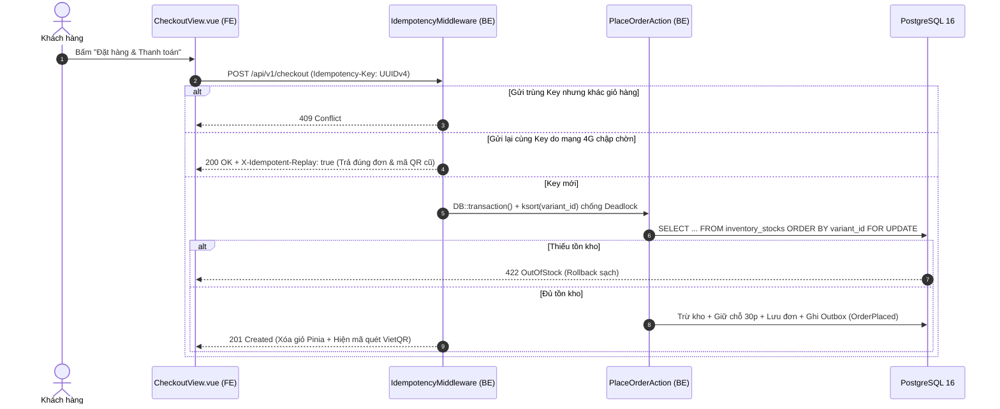
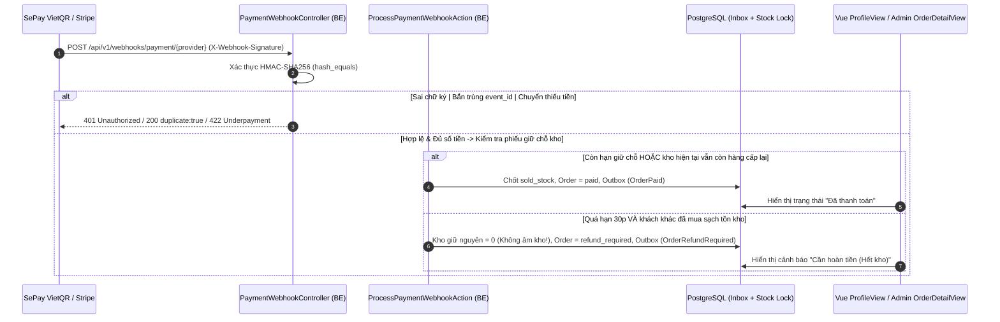

# CleanCommerce — Laravel 13 Hexagonal Clean Architecture API + Enterprise Vue 3.5 SPA

Kiến trúc thương mại điện tử tổ chức chặt chẽ theo nguyên tắc **"Cái nào cần riêng thì riêng, cái nào cần chung thì chung (`0%` trùng lặp)"**:

1. **PHẦN RIÊNG (`backend/` & `frontend/` — Tự chủ 100%, Polyrepo-Ready):**
   - Mỗi thư mục tự sở hữu trọn bộ `.env.example`, `Dockerfile`, `docker-compose.yml` và tài liệu nội bộ chuyên môn của riêng mình (`backend/docs/LAW.md` & `MODULE_MAP.md`; `frontend/docs/DESIGN.md`).
   - `backend/` thuần 100% JSON REST API (`0` `vite.config.js`, `0` `package.json`); `frontend/` phân tầng chuẩn Enterprise Vue 3 (`assets`, `components`, `composables`, `layouts`, `modules`, `router`, `services`, `stores`, `utils`).
2. **PHẦN CHUNG (`compose.yaml` & `docs/` tại gốc — Nhìn thấu toàn hệ thống khớp nhau 1:1):**
   - `compose.yaml` (chuẩn Docker Compose v2.20+ `include:`) gộp chạy toàn bộ **9 containers chỉ bằng 1 câu lệnh** trên mạng cầu `cleancommerce-shared-net` mà không lặp lại một dòng cấu hình nào.
   - `docs/API_CONTRACT.md` & `docs/ARCHITECTURE.md` là **Nguồn sự thật duy nhất** ánh xạ 1:1 từng màn hình/hàm `Axios Service` bên Frontend sang đúng `Route -> Controller -> UseCase Action -> Domain Port -> PostgreSQL` bên Backend.

---

## 1. Cấu Trúc Thư Mục Phân Định Rõ `CHUNG` vs `RIÊNG`

```text
VueLaravelProject/
├── compose.yaml                     # [CHUNG] Docker Compose v2 `include:` nối backend + frontend (0 lặp YAML)
├── AGENTS.md / CLAUDE.md            # [CHUNG] Trạm điều hướng cho AI Agents (Antigravity, Claude Code, Codex)
├── README.md                        # [CHUNG] Tổng quan toàn hệ thống & hướng dẫn khởi chạy
├── docs/                            # [CHUNG] Tài liệu kết nối liên miền (Single Source of Truth)
│   ├── ARCHITECTURE.md              #   ├─ Sơ đồ khớp nối đầu-cuối FE <-> API <-> BE <-> DB & 6 sự cố Cloud
│   ├── API_CONTRACT.md              #   ├─ Bảng ánh xạ 1:1 toàn bộ 22 Endpoints (Vue View <-> Axios <-> Laravel Action)
│   └── WBS.md                       #   └─ Phạm vi tổng thể & Cổng nghiệm thu Full-Stack
│
├── backend/                         # [RIÊNG] Dịch vụ Laravel 13 Pure Headless API (0 vite.config.js)
│   ├── .env.example & Dockerfile & docker-compose.yml (8 containers độc lập)
│   ├── AGENTS.md / CLAUDE.md & README.md
│   ├── docs/                        #   ├─ Chỉ chứa tài liệu nội bộ PHP/Hexagonal:
│   │   ├── LAW.md                   #   │  Luật 4 vòng Pure PHP, Money BIGINT, ksort + FOR UPDATE, Outbox, Pint
│   │   ├── MODULE_MAP.md            #   │  Bản đồ 7 Bounded Contexts, Ports <-> Adapters & outbox:relay
│   │   └── WBS.md                   #   │  Cổng kiểm thử độc lập Backend (`composer lint && composer test`)
│   └── app/{Core/SharedKernel, Modules/7-Bounded-Contexts}
│
└── frontend/                        # [RIÊNG] Dịch vụ Enterprise Vue 3.5 + TS + Axios + Pinia + SCSS
    ├── .env.example & Dockerfile & docker-compose.yml (Container SPA độc lập)
    ├── AGENTS.md / CLAUDE.md & README.md
    ├── docs/                        #   ├─ Chỉ chứa tài liệu nội bộ UI/Frontend:
    │   ├── DESIGN.md                #   │  Calm Daylight 60-30-10 SCSS Tokens, Anti-Slop & Chuẩn cây `src/`
    │   └── WBS.md                   #   │  Cổng kiểm thử độc lập Frontend (`npm run build` & `fe-gate.mjs`)
    └── src/{assets, components, composables, layouts, modules, router, services, stores, types, utils}
```

### Danh Mục Tài Liệu Đọc Nhanh
- **Tích hợp Toàn hệ thống (`PHẦN CHUNG`):** [docs/ARCHITECTURE.md](./docs/ARCHITECTURE.md) · [docs/API_CONTRACT.md](./docs/API_CONTRACT.md) · [docs/WBS.md](./docs/WBS.md)
- **Chuyên sâu nội bộ Backend (`PHẦN RIÊNG`):** [backend/docs/LAW.md](./backend/docs/LAW.md) · [backend/docs/MODULE_MAP.md](./backend/docs/MODULE_MAP.md) · [backend/docs/WBS.md](./backend/docs/WBS.md)
- **Chuyên sâu nội bộ Frontend (`PHẦN RIÊNG`):** [frontend/docs/DESIGN.md](./frontend/docs/DESIGN.md) · [frontend/docs/WBS.md](./frontend/docs/WBS.md)

---

## 2. Sơ Đồ Khớp Nối Đầu-Cuối Toàn Hệ Thống (`Frontend <-> API Contract <-> Backend <-> Infra`)



---

## 3. Hai Luồng Giao Dịch Xuyên Miền & Chống Sập Thực Chiến

### 3.1 Đặt Hàng Xuyên Miền (`Vue CheckoutView -> Idempotency -> Sorted Lock FOR UPDATE -> Outbox`)



### 3.2 Webhook Ngân Hàng HMAC, Chống Trùng Inbox & Xử Lý Chuyển Khoản Trễ Quá Hạn Giữ Chỗ



*(Xem trọn bộ bảng ánh xạ 22 endpoints tại [docs/API_CONTRACT.md](./docs/API_CONTRACT.md) và 6 bài học sự cố Cloud thực chiến tại [docs/ARCHITECTURE.md](./docs/ARCHITECTURE.md)).*

---

## 4. Ba Chế Độ Khởi Chạy Linh Hoạt (`Chung` hoặc `Riêng`)

### Chế độ 1 — Bật Chung Toàn Hệ Thống 9 Containers Từ Gốc (`compose.yaml`)
```bash
docker compose up -d --build
docker compose exec api php artisan migrate --seed --force
```
- **Frontend SPA (`Storefront` + `Admin`):** http://localhost:5173
- **Headless REST API:** http://localhost:8080/api/v1/health · **Mailpit:** http://localhost:8025 · **Meilisearch:** http://localhost:7700

### Chế độ 2 — Bật Riêng Từng Dịch Vụ Khi Tách Team / Tách Repo
```bash
# Nhóm Backend chạy riêng cụm 8 containers của mình:
cd backend && cp -n .env.example .env && docker compose up -d --build

# Nhóm Frontend chạy riêng container SPA của mình:
cd frontend && cp -n .env.example .env && docker compose up -d --build
```

### Chế độ 3 — Phát Triển Nhanh Trên Máy Local (Không Bật Docker)
```bash
# Terminal 1 (Backend API + SQLite):
cd backend && composer lint && composer test && php artisan migrate:fresh --seed && php artisan serve --port=8080

# Terminal 2 (Frontend Vue 3 SPA):
cd frontend && npm run dev
```

### Tài Khoản & Mã Giảm Giá Seed Sẵn
- **Quản trị viên (`/admin`):** `admin@cleancommerce.vn` / `Admin@123456`
- **Khách hàng:** `khachhang@cleancommerce.vn` / `Customer@123456` *(có nút điền nhanh tại `/auth/login`)*
- **Voucher thử nghiệm:** `WELCOME10` · `VIP200K` · `FREESHIP`
