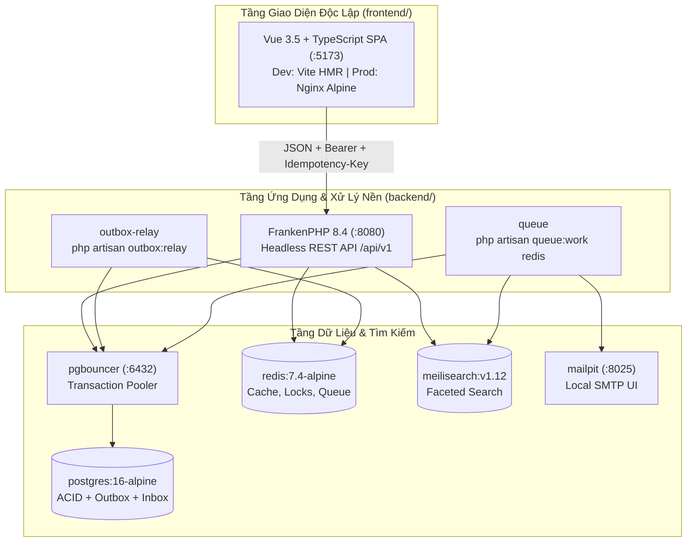
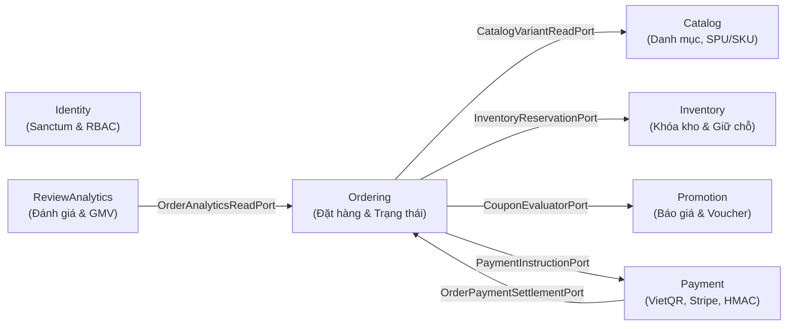
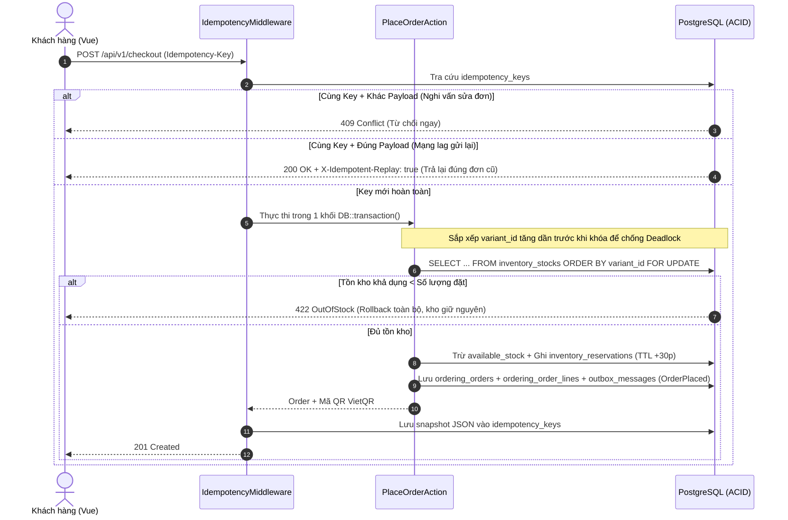
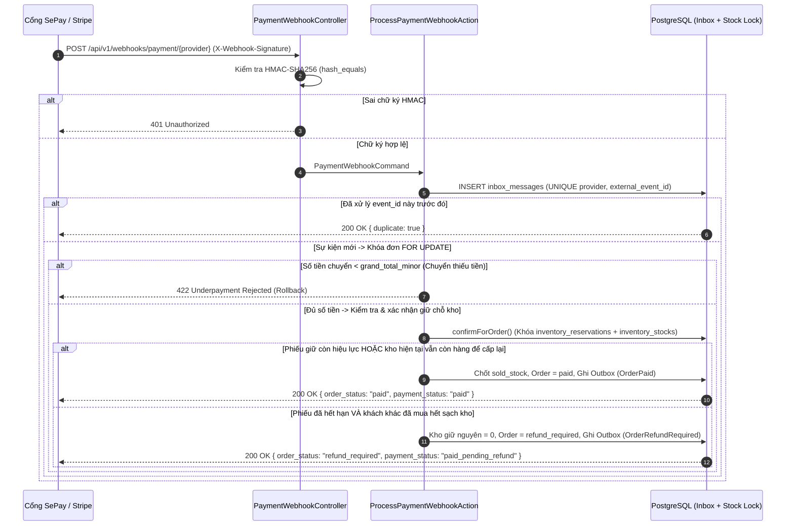
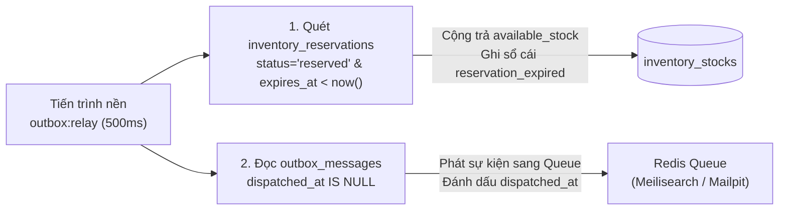

# System Architecture, Multi-Flow Sequences & Cloud Production Scars (`docs/ARCHITECTURE.md`)

> Tài liệu mô tả toàn cảnh kiến trúc hạ tầng, bản đồ 7 Bounded Contexts, **đầy đủ 4 luồng nghiệp vụ trọng yếu kèm tình huống lỗi biên (Edge Cases)** và **Sổ tay bài học thực chiến từ sự cố Cloud/Cộng đồng 2025–2026**.
> *Quy chuẩn sơ đồ:* Tối ưu tương phản cho cả **Dark Mode** và **Light Mode** trong Markdown Preview (không dùng khối nền trắng đặc gây lóa chữ).

---

## 1. Sơ Đồ Hạ Tầng Docker Compose (`9 Self-Contained Containers`)

---

## 2. Bản Đồ 7 Bounded Contexts & Giao Tiếp Qua `Ports`

| Bounded Context | Bảng Sở Hữu Riêng | Port Cung Cấp Cho Miền Khác |
| :--- | :--- | :--- |
| **`Identity`** | `users`, `personal_access_tokens` | `IdentityAuthPort` |
| **`Catalog`** | `catalog_categories`, `catalog_products`, `catalog_variants` | `CatalogRepositoryPort`, `CatalogVariantReadPort` |
| **`Inventory`** | `inventory_stocks`, `inventory_reservations`, `inventory_movements` | `InventoryReservationPort`, `InventoryStockReadPort` |
| **`Promotion`** | `promotion_coupons` | `CouponEvaluatorPort` |
| **`Ordering`** | `ordering_orders`, `ordering_order_lines` | `OrderingRepositoryPort`, `OrderPaymentSettlementPort`, `OrderAnalyticsReadPort` |
| **`Payment`** | `payment_transactions`, `inbox_messages` | `PaymentInstructionPort`, `PaymentInboxPort` |
| **`ReviewAnalytics`** | `product_reviews` | `ProductReviewReadPort`, `ReviewRepositoryPort` |
| **`SharedKernel`** | `outbox_messages`, `idempotency_keys` | `OutboxPort`, `IdempotencyMiddleware` |

---

## 3. Phân Tích Toàn Diện Các Luồng Nghiệp Vụ & Tình Huống Biên (`Multi-Flow & Edge-Case Sequences`)

### 3.1 Luồng Đặt Hàng Idempotent, Chống Deadlock & Chống Bán Lố Flash Sale

Xử lý đồng thời 4 tình huống: **(1) Bấm đúp / Mạng lag gửi lại đơn**, **(2) Sửa body trên cùng `Idempotency-Key`**, **(3) Tranh chấp dòng tồn kho cuối cùng**, và **(4) Đặt nhiều SKU ngược thứ tự gây Deadlock**.

### 3.2 Luồng Webhook HMAC, Chống Trùng Inbox & Bẫy "Chuyển Khoản Trễ Sau Khi Hết Giữ Chỗ"

Trong thực tế vận hành VietQR / Stripe ngày Flash Sale, có **4 kịch bản hiểm hóc** phải chặn sạch:
1. **Giả mạo chữ ký Webhook** -> Chặn `401 Unauthorized`.
2. **Sửa số tiền chuyển khoản thấp hơn giá trị đơn (`Underpayment Tampering`)** -> Chặn `422 Unprocessable`, giữ nguyên `unpaid`.
3. **Ngân hàng bắn trùng gói tin (`At-least-once retry`)** -> Bảng `inbox_messages` chặn trùng, trả `200 duplicate: true`.
4. **Khách chuyển khoản trễ sau khi hết hạn giữ chỗ 30 phút (`Black Friday Phantom Order Trap`):** Khách A giữ món hàng cuối nhưng 35 phút sau mới chuyển tiền; lúc đó `outbox:relay` đã thu hồi kho và Khách B đã mua mất. Hệ thống **tuyệt đối không để âm kho**, tự động chuyển sang `status = refund_required` (`payment_status = paid_pending_refund`) và phát sự kiện `OrderRefundRequired` để hoàn tiền minh bạch.

### 3.3 Luồng Outbox Relay, Quét Giữ Chỗ Quá Hạn & Hủy Đơn Hoàn Kho

### 3.4 Luồng Xác Thực Bearer Token, Phân Quyền RBAC & Chống Xem Trộm Đơn (`Anti-BOLA`)

- **Tách phiên sạch cho Octane/FrankenPHP:** `FreshBearerTokenMiddleware` làm sạch bộ nhớ đệm Guard giữa các request để tránh rò rỉ tài khoản khi chạy Worker Mode dài hạn.
- **Chống BOLA/IDOR ở `GET /api/v1/orders/{orderNumber}`:** Khách hàng `user_id = 2` cố tình đoán mã đơn của `user_id = 5` bị chặn `403 Forbidden` ngay tại tầng Application.
- **Khóa chặt `/api/v1/admin/*`:** `AdminRoleMiddleware` trả `401` JSON chuẩn khi thiếu token (không redirect về trang HTML `/login`) và `403` nếu `role !== 'admin'`.

---

## 4. Sổ Tay Bài Học Thực Chiến Cloud & Cộng Đồng (`Anti-Out-of-Meta Ledger 2025–2026`)

Tổng hợp từ các báo cáo sự cố thực tế (Post-mortems Black Friday, GitHub Issues Laravel Octane/FrankenPHP, PgBouncer & VietQR/Stripe):

| # | Sự cố thực tế người dùng hay gặp trên Cloud | Nguyên nhân gốc (`Root Cause`) | Giải pháp đã tích hợp sẵn trong dự án |
| :-: | :--- | :--- | :--- |
| **1** | Lỗi `prepared statement "pdo_stmt_..." already exists` khi bật PgBouncer tải cao | PgBouncer ở chế độ `POOL_MODE=transaction` luân chuyển kết nối vật lý giữa các câu lệnh, làm xung đột Prepared Statement gốc của PDO | Đã cấu hình `PDO::ATTR_EMULATE_PREPARES => true` cho `pgsql` tại `backend/config/database.php` |
| **2** | Âm tồn kho ("Phantom Orders") khi ngân hàng báo chuyển khoản chậm sau 30 phút | Hết TTL giữ chỗ, kho nhả ra cho người khác mua, nhưng Webhook đến trễ vẫn đổi đơn cũ thành `paid` mà không kiểm tra lại kho | `EloquentInventoryAdapter::confirmForOrder()` tự thử cấp phát lại có khóa dòng; nếu hết sạch hàng sẽ chuyển sang `refund_required` + phát `OrderRefundRequired` |
| **3** | Gian lận sửa số tiền khi quét mã VietQR động | Khách sửa tay số tiền chuyển từ `890.000₫` xuống `10.000₫` nhưng giữ nguyên nội dung chuyển khoản `ORD-...` | `EloquentOrderingAdapter::settlePaidOrder()` đối chiếu cứng `paidAmountMinor >= grand_total_minor` trước khi gạch nợ |
| **4** | Treo DB (`Deadlock`) khi 2 khách đặt giỏ hàng có cùng cặp SKU ngược thứ tự | Giao dịch 1 khóa `[SKU_1, SKU_2]`, giao dịch 2 khóa `[SKU_2, SKU_1]` cùng mili-giây | `ksort($variantQuantities)` + `ORDER BY variant_id` trước mọi lệnh `lockForUpdate()` |
| **5** | Trừ kho 2 lần khi mạng 4G chập chờn khách bấm thanh toán liên tục | Frontend gửi lặp `POST /checkout` khi chưa nhận được phản hồi | Cấp `crypto.randomUUID()` làm `Idempotency-Key` ở `CheckoutView.vue` + lưu snapshot tại `idempotency_keys` |
| **6** | Rò rỉ thông tin đăng nhập giữa 2 khách hàng trên FrankenPHP / Octane | Worker giữ nguyên bộ nhớ tiến trình PHP qua nhiều request liên tiếp | Dùng `readonly` Action/Adapter không lưu biến tĩnh (`static`) + `FreshBearerTokenMiddleware` |
