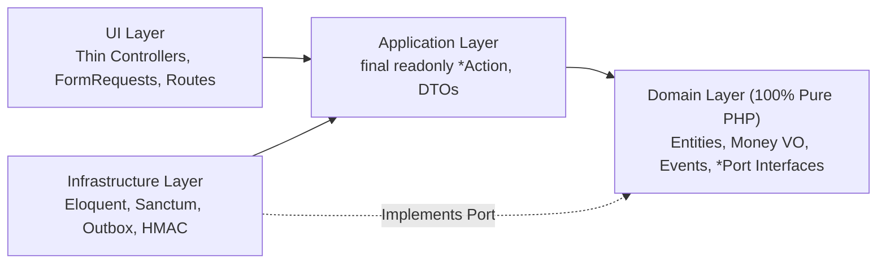

# Backend Internal Architecture Laws (`backend/docs/LAW.md`)  
*(Luật Kiến Trúc Nội Bộ Backend (`backend/docs/LAW.md`))*

- **Scope**: Standalone internal constitution for `backend/` — defines immutable rules for the Laravel 13 Pure Headless API, enforced by `ArchitectureBoundaryTest`, `composer lint` (Laravel Pint), and `backend-gate.mjs`.  
  *(**Phạm vi**: Tài liệu RIÊNG của `backend/` — quy định các luật bất biến của Laravel 13 Pure Headless API, được kiểm tra tự động bởi `ArchitectureBoundaryTest`, `composer lint` (Laravel Pint) và `backend-gate.mjs`.)*

- **Shared API Contract**: See [../../docs/API_CONTRACT.md](../../docs/API_CONTRACT.md) for cross-service frontend/backend endpoints.  
  *(**Hợp đồng API chung**: Xem [../../docs/API_CONTRACT.md](../../docs/API_CONTRACT.md) cho các endpoint giao tiếp với Frontend.)*

---

## 1. 4-Ring Hexagonal Dependency Law  
*(Luật Phụ Thuộc 4 Vòng Đồng Tâm (`Hexagonal Dependency Rule`))*

| Layer | Allowed Contents | Strictly Forbidden (Enforced by `ArchitectureBoundaryTest`) |
| :--- | :--- | :--- |
| **`Domain/`** | `readonly` Entities, `Money` VO, Domain Events, `Contracts/*Port.php` | `Illuminate\*`, `Laravel\*`, Eloquent Models, `Request`, `DB::`, third-party SDKs |
| **`Application/`** | `final readonly *Action.php` (UseCases), `DTOs`, calling Domain `*Port` interfaces | Direct Eloquent queries or returning `JsonResponse` |
| **`Infrastructure/`** | Eloquent Models, `*Adapter.php` implementing `*Port`, Migrations, Outbox/Inbox | Core pricing/discount rules or importing another module's `Infrastructure` |
| **`UI/`** | Thin API Controllers (`<= 30` lines/method), Validation, JSON formatting | `DB::transaction`, `lockForUpdate`, or business branching logic |

---

## 2. Pure Headless API & FrankenPHP Worker Hygiene  
*(Luật Vệ Sinh Pure Headless API & FrankenPHP Worker)*

1. **100% Pure API (`Zero Frontend Artifacts`)**: `backend/` must never contain `vite.config.js`, `package.json`, `node_modules/`, `resources/js/`, or `resources/css/`.  
   *(**Thuần API 100% (`Zero Frontend Artifacts`)**: Thư mục `backend/` tuyệt đối không chứa `vite.config.js`, `package.json`, `node_modules/`, `resources/js/` hay `resources/css/`.)*

2. **Strict Types & PSR-12**: Every PHP file in `app/`, `routes/`, and `tests/` declares `declare(strict_types=1);` and passes `./vendor/bin/pint --test` (`composer lint`).  
   *(**Strict Types & PSR-12**: Mọi file PHP trong `app/`, `routes/`, `tests/` bật `declare(strict_types=1);` và vượt qua `./vendor/bin/pint --test` (`composer lint`).)*

3. **Long-Lived Worker Safety (`FrankenPHP / Octane Safe`)**: Never store per-request state in `static` properties inside Actions/Adapters; always pass through `FreshBearerTokenMiddleware` to reset Guard state between requests.  
   *(**An toàn Worker dài hạn (`FrankenPHP / Octane Safe`)**: Cấm lưu trạng thái request vào biến `static` trong Action/Adapter; bắt buộc đi qua `FreshBearerTokenMiddleware` để làm sạch bộ nhớ đệm Guard giữa các request.)*

4. **PgBouncer `transaction` Mode Compatibility**: The `pgsql` connection in `config/database.php` enables `PDO::ATTR_EMULATE_PREPARES => true` to prevent prepared statement collisions under high concurrency.  
   *(**Tương thích PgBouncer `transaction` mode**: Kết nối `pgsql` tại `config/database.php` luôn bật `PDO::ATTR_EMULATE_PREPARES => true` để triệt tiêu lỗi đụng độ prepared statements khi chịu tải cao.)*

---

## 3. Money, High-Concurrency Inventory & Payment Safety Laws  
*(Luật Tiền Tệ, Tồn Kho Tải Cao & Thanh Toán An Toàn)*

1. **Integer Minor Units Only**: Store every monetary database column as `BIGINT` (`*_minor`) and compute through `App\Core\SharedKernel\Domain\ValueObjects\Money` — never use `float` or `double`.  
   *(**Tiền tệ số nguyên (`Integer Minor Units Only`)**: Mọi cột tiền trong DB là `BIGINT` (`*_minor`), tính toán qua `App\Core\SharedKernel\Domain\ValueObjects\Money` — cấm tuyệt đối `float` / `double`.)*

2. **Anti-Oversell & Anti-Deadlock (`Sorted Pessimistic Lock`)**: Always sort variant keys via `ksort($variantQuantities)` + `ORDER BY variant_id` before executing `SELECT ... FOR UPDATE` (`lockForUpdate()`).  
   *(**Chống bán lố & Chống Deadlock (`Sorted Pessimistic Lock`)**: Luôn `ksort($variantQuantities)` + `ORDER BY variant_id` trước khi gọi `SELECT ... FOR UPDATE` (`lockForUpdate()`).)*

3. **Idempotency, Webhook Inbox & Late-Payment Guard**:  
   *(**Chống đặt trùng, Trừ tiền kép & Xử lý chuyển khoản trễ**:)*

   - `POST /api/v1/checkout` requires `IdempotencyMiddleware` (`Idempotency-Key` + SHA-256 payload fingerprint check).  
     *(Endpoint `POST /api/v1/checkout` bắt buộc qua `IdempotencyMiddleware` (`Idempotency-Key` + đối chiếu mã băm SHA-256 của payload).)*

   - `POST /api/v1/webhooks/payment/{provider}` verifies `HMAC-SHA256` (`hash_equals`), deduplicates via `inbox_messages`, rejects underpayment (`422`), and transitions to `refund_required` (`OrderRefundRequired`) if a late payment arrives after the stock reservation expired and sold out.  
     *(Endpoint `POST /api/v1/webhooks/payment/{provider}` xác thực `HMAC-SHA256` (`hash_equals`), chặn trùng qua `inbox_messages`, chặn chuyển thiếu tiền (`422`), và chuyển sang `refund_required` (`OrderRefundRequired`) nếu khách chuyển tiền trễ sau khi kho giữ chỗ đã hết hạn và bán sạch.)*

4. **Anti-BOLA / IDOR**: Verify order ownership at the Application layer; protect `/api/v1/admin/*` with `auth:sanctum` + `AdminRoleMiddleware` and block admins from demoting themselves (`422`).  
   *(**Chống BOLA / IDOR**: Đối chiếu chủ sở hữu đơn hàng ở tầng Application; khóa nhánh `/api/v1/admin/*` bằng `auth:sanctum` + `AdminRoleMiddleware` và chặn Admin tự hạ quyền chính mình (`422`).)*
