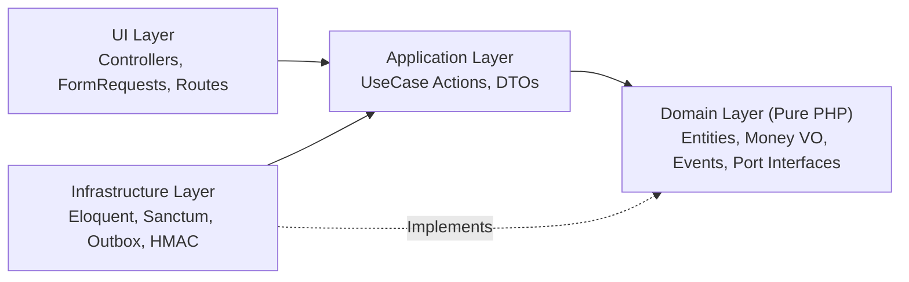

# Engineering Constitution & Immutable Laws (`docs/LAW.md`)

> Tài liệu này quy định các **luật bất biến** của dự án. Mọi Pull Request từ con người hoặc AI Agent vi phạm các điều khoản dưới đây đều bị chặn tự động bởi `ArchitectureBoundaryTest` và bộ cổng CI.

---

## 1. Luật Phụ Thuộc 4 Vòng Đồng Tâm (`Hexagonal Dependency Rule`)

| Tầng | Được phép chứa | CẤM TUYỆT ĐỐI (Kiểm tra tự động bởi Test) |
| :--- | :--- | :--- |
| **`Domain/`** | `readonly` Entities, `Money` VO, Domain Events, `Contracts/*Port.php` | `Illuminate\*`, `Laravel\*`, Eloquent Models, `Request`, `DB::`, SDK bên thứ 3 |
| **`Application/`** | `*Action.php` (UseCases), `DTOs`, gọi các `Port` của Domain | Viết truy vấn Eloquent trực tiếp hoặc trả về `JsonResponse` |
| **`Infrastructure/`** | Eloquent Models, `*Adapter.php` thực thi `Port`, Migrations, Outbox/Inbox | Chứa luật tính giá/khuyến mãi cốt lõi hoặc gọi sang `Infrastructure` của Module khác |
| **`UI/`** | Thin API Controllers (`<= 30` dòng/hàm), Validation, JSON formatting | Viết `DB::transaction`, `lockForUpdate` hoặc logic rẽ nhánh nghiệp vụ |

---

## 2. Luật Cô Lập Giữa Các Bounded Contexts (`Modular Monolith Law`)

1. **Cấm gọi chéo `Infrastructure`:** Module `Ordering` **không bao giờ** được `use App\Modules\Catalog\Infrastructure\...` hay `App\Modules\Inventory\Infrastructure\...`.
2. **Giao tiếp đồng bộ (Đọc/Giữ kho):** Bắt buộc đi qua `Domain\Contracts\*Port` được đăng ký tập trung tại `app/Providers/ModulesServiceProvider.php`.
3. **Giao tiếp bất đồng bộ (Tác vụ phụ):** Mọi sự kiện liên miền (`OrderPlaced`, `OrderPaid`, `OrderCancelled`) phải ghi vào bảng `outbox_messages` **cùng một `DB::transaction()`** với dữ liệu nghiệp vụ (*Transactional Outbox Pattern* — chống lỗi mất sự kiện Dual-Write).

---

## 3. Luật Tiền Tệ, Tồn Kho Tải Cao & Thanh Toán An Toàn

1. **Tiền tệ số nguyên (`Integer Minor Units Only`):**
   - Mọi cột giá, giảm giá, phí vận chuyển, tổng tiền trong DB đều là `BIGINT` (`*_minor`) và xử lý trong PHP qua `App\Core\SharedKernel\Domain\ValueObjects\Money`.
   - **Cấm dùng `float` / `double`** để cộng trừ hoặc tính phần trăm tiền tệ.
2. **Chống bán lố Flash Sale (`Pessimistic Lock + Sorted Acquisition`):**
   - Khi đặt hàng nhiều SKU cùng lúc, `EloquentInventoryAdapter` bắt buộc **sắp xếp `variant_id` tăng dần** trước khi gọi `SELECT ... FOR UPDATE` (`lockForUpdate()`) để vừa chống âm kho (*Race Condition*), vừa triệt tiêu nguy cơ *Deadlock* giữa 2 giao dịch ngược thứ tự.
3. **Chống đặt trùng & Trừ tiền kép (`Idempotency + Webhook Inbox`):**
   - `POST /api/v1/checkout` bắt buộc đi qua `IdempotencyMiddleware` (`Idempotency-Key` header). Gửi lại cùng key + cùng body trả về nguyên trạng đơn cũ (`X-Idempotent-Replay: true`); cùng key nhưng sửa body trả về `409 Conflict`.
   - `POST /api/v1/webhooks/payment/{provider}` bắt buộc kiểm tra chữ ký `X-Webhook-Signature` (`HMAC-SHA256` bằng `hash_equals`) trước khi đọc dữ liệu, sau đó chốt chặn trùng lặp bằng ràng buộc `UNIQUE(provider, external_event_id)` tại bảng `inbox_messages`.
4. **Chống xem trộm đơn hàng (`OWASP BOLA / IDOR`):**
   - Mọi truy vấn chi tiết đơn hàng của khách phải đối chiếu chủ sở hữu (`user_id`); toàn bộ nhánh `/api/v1/admin/*` phải đi qua `auth:sanctum` + `AdminRoleMiddleware` (`role === 'admin'`).

---

## 4. Luật Tách Biệt Frontend & Tiêu Chuẩn Giao Diện (`UI Anti-Slop Law`)

1. **Độc lập 100% FE / BE:** Không cài Inertia, Livewire hay trả HTML từ `backend/`. Mọi kết nối từ `frontend/` chỉ đi qua `frontend/src/shared/api/client.ts`.
2. **Design System tập trung:** Toàn bộ màu sắc, khoảng cách (hệ 4px), bo góc và bóng đổ trong `frontend/` lấy từ biến CSS `:root` định nghĩa tại `frontend/DESIGN.md` & `frontend/src/styles/tokens.css`.
3. **Chống AI Slop:** Cấm dùng chữ/nền gradient tím-xanh, cấm dùng Emoji làm icon giao diện (dùng bộ SVG nét mảnh đồng nhất `AppIcon.vue`), cấm `transition: all`, và bắt buộc bật `font-variant-numeric: tabular-nums` cho toàn bộ giá tiền & số liệu thống kê.
