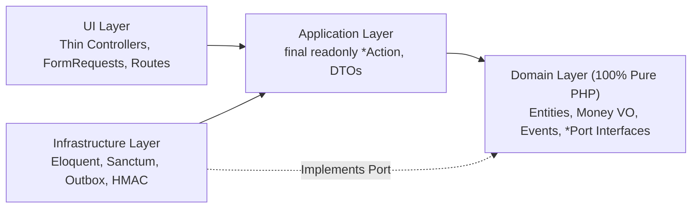

# Luật Kiến Trúc Nội Bộ Backend (`backend/docs/LAW.md`)

> **Phạm vi:** Tài liệu **RIÊNG** của `backend/` — quy định các luật bất biến của Laravel 13 Pure Headless API. Mọi vi phạm đều bị chặn tự động bởi `ArchitectureBoundaryTest`, `composer lint` (Laravel Pint) và `backend-gate.mjs`.
> Hợp đồng giao tiếp với Frontend xem tại [../../docs/API_CONTRACT.md](../../docs/API_CONTRACT.md).

---

## 1. Luật Phụ Thuộc 4 Vòng Đồng Tâm (`Hexagonal Dependency Rule`)

| Tầng | Được phép chứa | CẤM TUYỆT ĐỐI (Kiểm tra tự động bởi `ArchitectureBoundaryTest`) |
| :--- | :--- | :--- |
| **`Domain/`** | `readonly` Entities, `Money` VO, Domain Events, `Contracts/*Port.php` | `Illuminate\*`, `Laravel\*`, Eloquent Models, `Request`, `DB::`, SDK bên thứ 3 |
| **`Application/`** | `final readonly *Action.php` (UseCases), `DTOs`, gọi các `*Port` của Domain | Viết truy vấn Eloquent trực tiếp hoặc trả về `JsonResponse` |
| **`Infrastructure/`** | Eloquent Models, `*Adapter.php` thực thi `*Port`, Migrations, Outbox/Inbox | Chứa luật tính giá/khuyến mãi cốt lõi hoặc `use` sang `Infrastructure` của Module khác |
| **`UI/`** | Thin API Controllers (`<= 30` dòng/hàm), Validation, JSON formatting | Viết `DB::transaction`, `lockForUpdate` hoặc logic rẽ nhánh nghiệp vụ |

---

## 2. Luật Vệ Sinh Pure Headless API & FrankenPHP Worker (`PHP Big Tech Craft`)

1. **Thuần API 100% (`Zero Frontend Artifacts`):** Thư mục `backend/` tuyệt đối không chứa `vite.config.js`, `package.json`, `node_modules/`, `resources/js/` hay `resources/css/`.
2. **Strict Types & PSR-12:** Mọi file PHP trong `app/`, `routes/`, `tests/` bật `declare(strict_types=1);` và vượt qua `./vendor/bin/pint --test` (`composer lint`).
3. **An toàn Worker dài hạn (`FrankenPHP / Octane Safe`):** Cấm lưu trạng thái request vào biến `static` trong Action/Adapter; bắt buộc đi qua `FreshBearerTokenMiddleware` để làm sạch bộ nhớ đệm Guard giữa các request.
4. **Tương thích PgBouncer `transaction` mode:** Kết nối `pgsql` tại `config/database.php` luôn bật `PDO::ATTR_EMULATE_PREPARES => true` để triệt tiêu lỗi đụng độ prepared statements khi chịu tải cao.

---

## 3. Luật Tiền Tệ, Tồn Kho Tải Cao & Thanh Toán An Toàn

1. **Tiền tệ số nguyên (`Integer Minor Units Only`):** Mọi cột tiền trong DB là `BIGINT` (`*_minor`), tính toán qua `App\Core\SharedKernel\Domain\ValueObjects\Money` — cấm tuyệt đối `float` / `double`.
2. **Chống bán lố & Chống Deadlock (`Sorted Pessimistic Lock`):** Luôn `ksort($variantQuantities)` + `ORDER BY variant_id` trước khi gọi `SELECT ... FOR UPDATE` (`lockForUpdate()`).
3. **Chống đặt trùng & Trừ tiền kép (`Idempotency + Webhook Inbox + Late-Payment Guard`):**
   - `POST /api/v1/checkout` bắt buộc qua `IdempotencyMiddleware` (`Idempotency-Key` + đối chiếu SHA-256 payload).
   - `POST /api/v1/webhooks/payment/{provider}` xác thực `HMAC-SHA256` (`hash_equals`), chặn trùng qua `inbox_messages`, chặn chuyển thiếu tiền (`422`), và chuyển sang `refund_required` (`OrderRefundRequired`) nếu khách chuyển tiền trễ sau khi kho giữ chỗ đã hết hạn và bán sạch.
4. **Chống BOLA / IDOR:** Đối chiếu chủ sở hữu đơn hàng ở tầng Application; khóa nhánh `/api/v1/admin/*` bằng `auth:sanctum` + `AdminRoleMiddleware` + chặn Admin tự hạ quyền chính mình (`422`).
