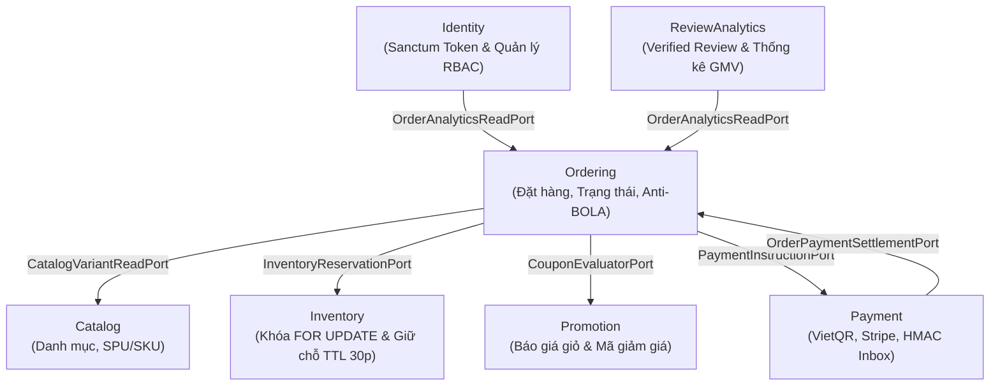
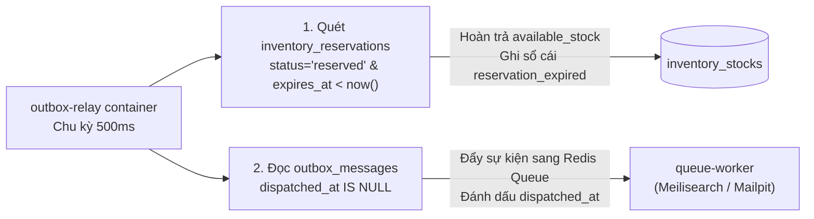

# Bản Đồ Nội Bộ 7 Bounded Contexts & Cơ Sở Dữ Liệu (`backend/docs/MODULE_MAP.md`)

> **Phạm vi:** Tài liệu **RIÊNG** của `backend/` — mô tả cấu trúc kết nối nội bộ giữa 7 Bounded Contexts, `SharedKernel`, bảng PostgreSQL sở hữu riêng và tiến trình nền `outbox:relay`.
> Để xem sơ đồ khớp nối xuyên sang Frontend Vue 3, mở [../../docs/ARCHITECTURE.md](../../docs/ARCHITECTURE.md).

---

## 1. Sơ Đồ Giao Tiếp Nội Bộ Qua `Domain Ports` (`app/Providers/ModulesServiceProvider.php`)

Các Module tuyệt đối không gọi trực tiếp Model hay Adapter của nhau mà chỉ giao tiếp qua `Domain\Contracts\*Port`:

---

## 2. Bảng Phân Quyền Sở Hữu Bảng Dữ Liệu & `Port <-> Adapter`

| Module (`app/Modules/*`) | Bảng DB Sở Hữu Riêng | Interface Cung Cấp (`Domain/Contracts/`) | Adapter Thực Thi (`Infrastructure/Persistence/`) |
| :--- | :--- | :--- | :--- |
| **`Identity`** | `users`, `personal_access_tokens` | `IdentityAuthPort` | `SanctumIdentityAdapter` |
| **`Catalog`** | `catalog_categories`, `catalog_products`, `catalog_variants` | `CatalogRepositoryPort`, `CatalogVariantReadPort` | `EloquentCatalogAdapter` |
| **`Inventory`** | `inventory_stocks`, `inventory_reservations`, `inventory_movements` | `InventoryReservationPort`, `InventoryStockReadPort` | `EloquentInventoryAdapter` |
| **`Promotion`** | `promotion_coupons` | `CouponEvaluatorPort` | `EloquentCouponEvaluatorAdapter` |
| **`Ordering`** | `ordering_orders`, `ordering_order_lines` | `OrderingRepositoryPort`, `OrderPaymentSettlementPort`, `OrderAnalyticsReadPort` | `EloquentOrderingAdapter` |
| **`Payment`** | `payment_transactions`, `inbox_messages` | `PaymentInstructionPort`, `PaymentInboxPort` | `EloquentPaymentAdapter` |
| **`ReviewAnalytics`** | `product_reviews` | `ProductReviewReadPort`, `ReviewRepositoryPort` | `EloquentReviewAdapter` |
| **`Core/SharedKernel`** | `outbox_messages`, `idempotency_keys` | `OutboxPort` + `IdempotencyMiddleware` | `EloquentOutboxAdapter` |

---

## 3. Chu Trình Tiến Trình Nền `php artisan outbox:relay`

