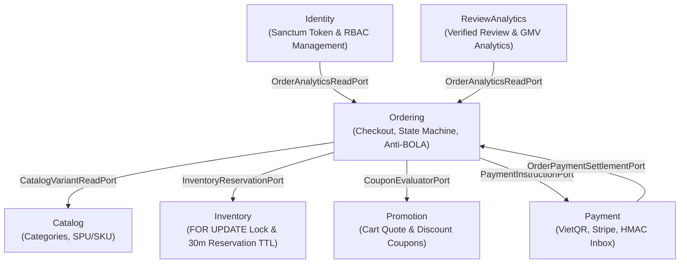
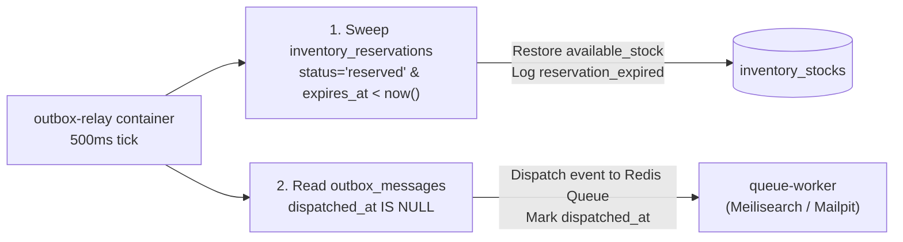

# Internal Map of 7 Bounded Contexts & Database Ownership (`backend/docs/MODULE_MAP.md`)  
*(Bản Đồ Nội Bộ 7 Bounded Contexts & Cơ Sở Dữ Liệu (`backend/docs/MODULE_MAP.md`))*

- **Scope**: Internal documentation for `backend/` — describes wiring across the 7 Bounded Contexts, `SharedKernel`, dedicated PostgreSQL tables, and the `outbox:relay` daemon.  
  *(**Phạm vi**: Tài liệu RIÊNG của `backend/` — mô tả cấu trúc kết nối nội bộ giữa 7 Bounded Contexts, `SharedKernel`, bảng PostgreSQL sở hữu riêng và tiến trình nền `outbox:relay`.)*

- **Cross-Service Architecture**: Open [../../docs/ARCHITECTURE.md](../../docs/ARCHITECTURE.md) for the end-to-end Vue 3 <-> Laravel 13 integration flow.  
  *(**Kiến trúc liên dịch vụ**: Mở [../../docs/ARCHITECTURE.md](../../docs/ARCHITECTURE.md) để xem sơ đồ khớp nối xuyên sang Frontend Vue 3.)*

---

## 1. Internal Communication via `Domain Ports` (`app/Providers/ModulesServiceProvider.php`)  
*(Sơ Đồ Giao Tiếp Nội Bộ Qua `Domain Ports` (`app/Providers/ModulesServiceProvider.php`))*

Modules never call each other's Eloquent Models or Adapters directly; all cross-module calls go through `Domain\Contracts\*Port`:  
*(Các Module tuyệt đối không gọi trực tiếp Model hay Adapter của nhau mà chỉ giao tiếp qua `Domain\Contracts\*Port`:)*

---

## 2. Database Table Ownership & `Port <-> Adapter` Bindings  
*(Bảng Phân Quyền Sở Hữu Bảng Dữ Liệu & `Port <-> Adapter`)*

| Module (`app/Modules/*`) | Dedicated DB Tables | Provided Interfaces (`Domain/Contracts/`) | Implementing Adapters (`Infrastructure/Persistence/`) |
| :--- | :--- | :--- | :--- |
| **`Identity`** | `users`, `personal_access_tokens` | `IdentityAuthPort` | `SanctumIdentityAdapter` |
| **`Catalog`** | `catalog_categories`, `catalog_products`, `catalog_variants` | `CatalogRepositoryPort`, `CatalogVariantReadPort` | `EloquentCatalogAdapter` |
| **`Inventory`** | `inventory_stocks`, `inventory_reservations`, `inventory_movements` | `InventoryReservationPort`, `InventoryStockReadPort` | `EloquentInventoryAdapter` |
| **`Promotion`** | `promotion_coupons` | `CouponEvaluatorPort` | `EloquentCouponEvaluatorAdapter` |
| **`Ordering`** | `ordering_orders`, `ordering_order_lines` | `OrderingRepositoryPort`, `OrderPaymentSettlementPort`, `OrderAnalyticsReadPort` | `EloquentOrderingAdapter` |
| **`Payment`** | `payment_transactions`, `inbox_messages` | `PaymentInstructionPort`, `PaymentInboxPort` | `EloquentPaymentAdapter` |
| **`ReviewAnalytics`** | `product_reviews` | `ProductReviewReadPort`, `ReviewRepositoryPort` | `EloquentReviewAdapter` |
| **`Core/SharedKernel`** | `outbox_messages`, `idempotency_keys` | `OutboxPort` + `IdempotencyMiddleware` | `EloquentOutboxAdapter` |

---

## 3. Background Daemon Cycle (`php artisan outbox:relay`)  
*(Chu Trình Tiến Trình Nền `php artisan outbox:relay`)*

- The `outbox-relay` daemon runs every 500ms to sweep expired stock reservations (`expires_at < now()`) and relay undispatched outbox events (`dispatched_at IS NULL`) to the Redis queue worker.  
  *(Tiến trình nền `outbox-relay` chạy mỗi 500ms để thu hồi các phiếu giữ kho quá hạn (`expires_at < now()`) và đẩy các sự kiện outbox chưa gửi (`dispatched_at IS NULL`) sang hàng đợi Redis.)*

