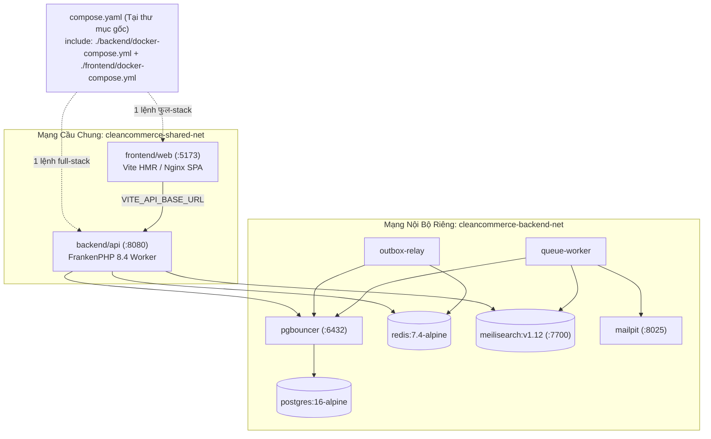
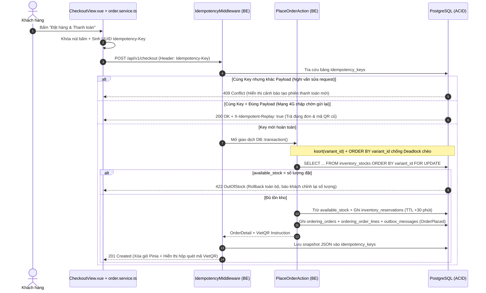
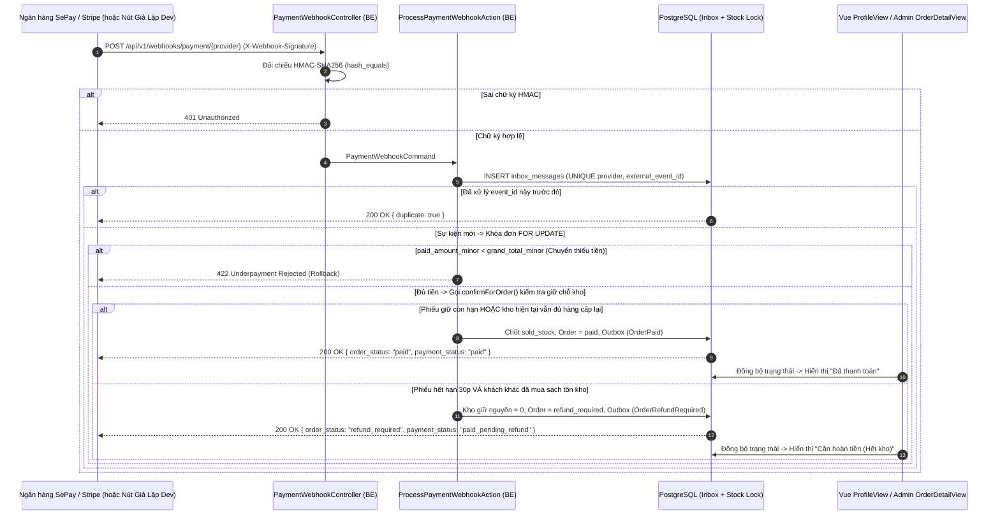

# Kiến Trúc Tích Hợp Toàn Hệ Thống & Khớp Nối Đầu-Cuối (`docs/ARCHITECTURE.md`)

> **Nguyên tắc thiết kế cốt lõi ("Cái gì cần riêng thì riêng, cái gì cần chung thì chung"):**
> - **Phần RIÊNG (`backend/`, `frontend/`):** Mỗi miền tự sở hữu `.env.example`, `Dockerfile`, `docker-compose.yml`, mã nguồn và tài liệu chuyên môn nội bộ (`backend/docs/LAW.md` & `MODULE_MAP.md`; `frontend/docs/DESIGN.md`) — sẵn sàng vận hành hoặc tách thành 2 Git repository độc lập bất kỳ lúc nào.
> - **Phần CHUNG (`compose.yaml`, `docs/`):** Điều phối Docker Compose v2 `include:` không lặp cấu hình, sơ đồ khớp nối xuyên miền (`Vue 3 SPA <-> REST /api/v1 <-> Laravel 13 Hexagonal <-> PostgreSQL/Redis`), các kịch bản giao dịch biên và Hợp đồng `API_CONTRACT.md` duy nhất.

---

## 1. Ma Trận Phân Định Ranh Giới `CHUNG` vs `RIÊNG` (`0%` Trùng Lặp)

| Tầng thành phần | Đặt tại PHẦN CHUNG (Root) | Đặt tại PHẦN RIÊNG (`backend/`) | Đặt tại PHẦN RIÊNG (`frontend/`) |
| :--- | :--- | :--- | :--- |
| **Biến môi trường** | *(Không đặt `.env` ở gốc)* | `backend/.env` & `.env.example` | `frontend/.env` & `.env.example` |
| **Đóng gói Container** | `compose.yaml` (`include:` gộp 2 cụm) | `backend/Dockerfile` & `docker-compose.yml` (`8` services) | `frontend/Dockerfile` & `docker-compose.yml` (`1` service) |
| **Hợp đồng giao tiếp** | `docs/API_CONTRACT.md` (**1 bản duy nhất + Bảng khớp 1:1 FE<->BE**) | Thực thi tại `backend/routes/api.php` | Tiêu thụ tại `frontend/src/services/*.ts` |
| **Luật & Kiến trúc** | `docs/ARCHITECTURE.md` (Khớp nối xuyên miền & Edge Cases) | `backend/docs/LAW.md` & `MODULE_MAP.md` (4 vòng Pure PHP & 7 Modules) | `frontend/docs/DESIGN.md` (Tokens 60-30-10, SCSS & Cây thư mục `src/`) |
| **Kế hoạch & Cổng kiểm** | `docs/WBS.md` (Nghiệm thu tích hợp Full-Stack) | `backend/docs/WBS.md` (`composer lint` & `composer test`) | `frontend/docs/WBS.md` (`npm run build` & `fe-gate.mjs`) |

---

## 2. Sơ Đồ Khớp Nối Đầu-Cuối Giữa Frontend, Backend & Hạ Tầng (`End-to-End System Matching`)

Sơ đồ dưới đây cho thấy **1 cú bấm của người dùng trên trình duyệt đi xuyên qua từng tầng của `frontend/` sang đúng tầng tương ứng của `backend/` và `PostgreSQL/Redis` như thế nào**:

```mermaid
flowchart LR
    subgraph FE["PHẦN RIÊNG 1: frontend/ (Enterprise Vue 3.5 + TS + SCSS)"]
        direction TB
        FELayout["layouts/\nCustomer · Admin · Auth"]
        FEView["modules/{auth,customer,admin}/views/\n13 Màn hình nghiệp vụ"]
        FEComp["composables/\nuseAuth · useCart · useNotification"]
        FEStore["stores/\nauth.store · cart.store · ui.store"]
        FESvc["services/\nauth · product · cart · order"]
        FEAxios["services/axiosClient.ts\nBearer Token + 401 Guard + Idempotency-Key"]

        FELayout --> FEView --> FEComp --> FEStore --> FESvc --> FEAxios
    end

    subgraph Contract["PHẦN CHUNG: Hợp Đồng Giao Tiếp"]
        HTTP["REST JSON /api/v1/*\n(22 Endpoints chuẩn hóa tại docs/API_CONTRACT.md)"]
    end

    subgraph BE["PHẦN RIÊNG 2: backend/ (Laravel 13 Pure Headless Hexagonal API)"]
        direction TB
        BEMw["UI Middleware\nFreshBearer · Sanctum · AdminRole · Idempotency"]
        BECtrl["UI Thin Controllers\n12 Controllers (<= 30 dòng/hàm)"]
        BEAct["Application Layer\nreadonly *Action + DTOs"]
        BEPort["Domain Layer (100% Pure PHP)\nEntities · Money VO · *Port Interfaces"]
        BEAdap["Infrastructure Layer\nEloquent *Adapter · Outbox · HMAC Inbox"]

        BEMw --> BECtrl --> BEAct --> BEPort
        BEAdap -.->|"Implements Port"| BEPort
    end

    subgraph Infra["Cụm Dữ Liệu & Worker (backend/docker-compose.yml)"]
        direction TB
        PGB["PgBouncer (:6432)\nTransaction Pooler"]
        PG[("PostgreSQL 16\nACID + FOR UPDATE + Outbox/Inbox")]
        Redis[("Redis 7.4\nCache & Queue")]
        Relay["outbox-relay (500ms)\nQuét hết hạn giữ chỗ & Đẩy Queue"]
        PGB --> PG
        Relay --> PGB
        Relay --> Redis
    end

    FEAxios ==>|"HTTP JSON + Headers"| HTTP ==> BEMw
    BEAdap --> PGB
    BEAdap --> Redis
```

---

## 3. Sơ Đồ Điều Phối Docker Compose `include:` (`Chạy Chung 1 Lệnh` hoặc `Chạy Riêng Từng Cụm`)

Nhờ chuẩn `include:` của Docker Compose v2.20+ và mạng cầu `cleancommerce-shared-net`, hai thư mục `backend/` và `frontend/` giữ nguyên tính độc lập 100% nhưng vẫn bật lên cùng nhau mượt mà từ thư mục gốc:

---

## 4. Phân Tích Các Luồng Tương Tác Xuyên Miền & Tình Huống Biên (`End-to-End Sequences`)

### 4.1 Luồng Đặt Hàng Xuyên Miền (`Vue CheckoutView -> Axios Idempotency -> Laravel Lock -> Postgres`)

Xử lý trọn vẹn **4 tình huống thực tế**: (1) Bấm đúp khi mạng lag, (2) Cố tình đổi giỏ hàng trên cùng `Idempotency-Key`, (3) Hai giỏ hàng khóa ngược thứ tự SKU gây Deadlock, và (4) Hết hàng giữa chừng ngày Flash Sale.

### 4.2 Luồng Thanh Toán Webhook HMAC, Chống Trùng Inbox & Bẫy "Chuyển Khoản Trễ Sau Khi Hết Hạn Giữ Chỗ"

Giải quyết dứt điểm **4 kịch bản hiểm hóc trong thanh toán ngân hàng thực tế**:
1. **Giả mạo chữ ký Webhook** -> Từ chối `401 Unauthorized` bằng `hash_equals`.
2. **Sửa số tiền chuyển khoản thấp hơn tổng đơn (`Underpayment`)** -> Từ chối `422 Unprocessable`, giữ nguyên `unpaid`.
3. **Ngân hàng bắn lặp gói tin (`At-least-once retry`)** -> Bảng `inbox_messages` chặn trùng, trả `200 { duplicate: true }`.
4. **Chuyển khoản trễ sau 35 phút khi kho đã bán hết cho khách khác (`Phantom Order Trap`):** Tuyệt đối không để âm kho; chuyển đơn sang `status = refund_required` (`payment_status = paid_pending_refund`), phát sự kiện `OrderRefundRequired`, và hiển thị nhãn **"Cần hoàn tiền (Hết kho)"** minh bạch trên cả `ProfileView.vue` (Khách) lẫn `OrderDetailView.vue` (Admin).

---

## 5. Sổ Tay 6 Sự Cố Thực Chiến Cloud & Cơ Chế Phối Hợp FE + BE (`Anti-Out-of-Meta Ledger`)

| # | Sự cố thực tế trên Cloud Production | Phía Backend xử lý (`backend/`) | Phía Frontend phối hợp (`frontend/`) |
| :-: | :--- | :--- | :--- |
| **1** | Lỗi `prepared statement "pdo_stmt_..." already exists` khi chạy qua PgBouncer `transaction` mode | Bật `PDO::ATTR_EMULATE_PREPARES => true` tại `backend/config/database.php` | Giữ kết nối API ổn định không bị lỗi `500` ngẫu nhiên khi tải cao |
| **2** | Âm tồn kho (*Phantom Orders*) khi khách chuyển khoản QR trễ sau khi hết 30p giữ chỗ | `confirmForOrder()` khóa dòng thử cấp lại; hết kho thì chuyển `refund_required` + `OrderRefundRequired` | `ProfileView.vue` & `OrderDetailView.vue` định nghĩa đầy đủ trạng thái `refund_required` / `paid_pending_refund` |
| **3** | Gian lận hạ số tiền khi quét mã VietQR động | `settlePaidOrder()` chặn `422` nếu `paidAmountMinor < grand_total_minor` | Khóa cứng số tiền trong payload QR & hiển thị cảnh báo nếu giao dịch chưa khớp |
| **4** | Treo DB (`Deadlock`) khi 2 giỏ hàng khóa cặp SKU ngược thứ tự | `ksort` + `ORDER BY variant_id` trước mọi lệnh `SELECT ... FOR UPDATE` | Hiển thị thông báo tồn kho tức thời từng dòng tại `CartView.vue` |
| **5** | Đặt trùng 2 đơn khi mạng di động lag | `IdempotencyMiddleware` đối chiếu SHA-256 payload & trả lại snapshot cũ | `orderService.checkout()` gắn `Idempotency-Key` UUIDv4 + khóa nút bấm khi đang gửi |
| **6** | Rò rỉ phiên đăng nhập trên FrankenPHP Worker / Token hết hạn | `final readonly` Actions không biến `static` + `FreshBearerTokenMiddleware` + Anti-BOLA `403` | `axiosClient.ts` tự dọn sạch `localStorage` khi gặp `401` và điều hướng về `/auth/login` |
