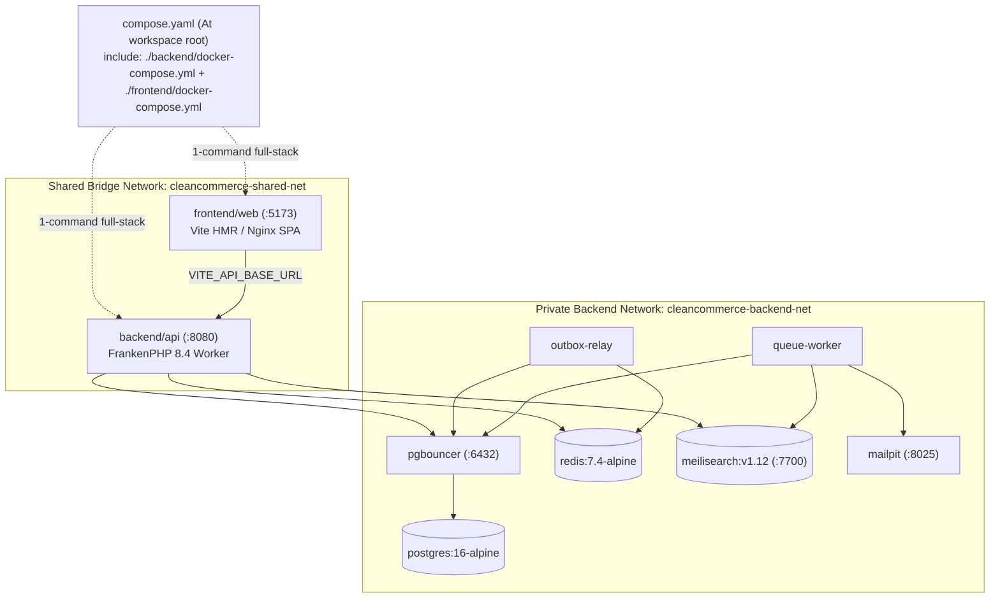
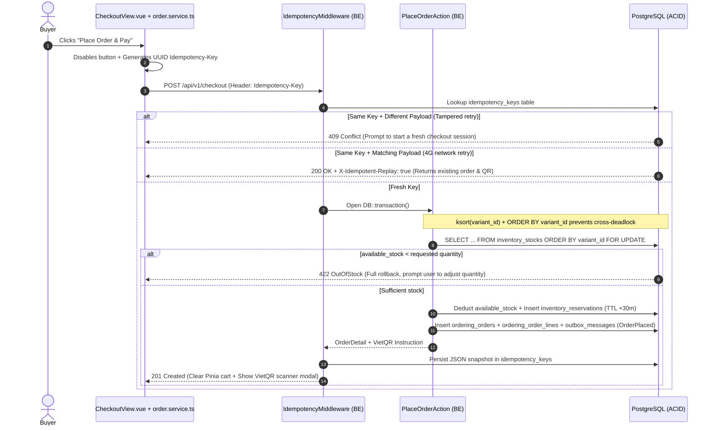
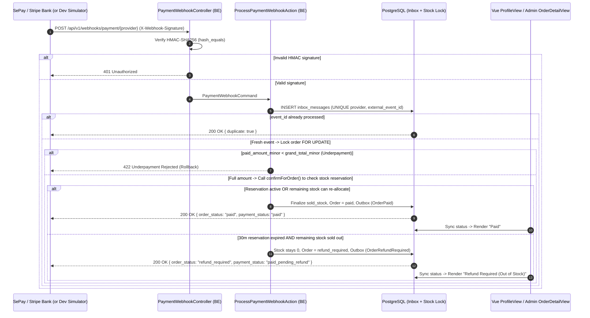

# System Integration Architecture & End-to-End Matching (`docs/ARCHITECTURE.md`)  
*(Kiến Trúc Tích Hợp Toàn Hệ Thống & Khớp Nối Đầu-Cuối (`docs/ARCHITECTURE.md`))*

- **Private Services (`backend/`, `frontend/`)**: Each service owns its `.env.example`, `Dockerfile`, `docker-compose.yml`, source tree, and internal docs (`backend/docs/LAW.md` & `MODULE_MAP.md`; `frontend/docs/DESIGN.md`), ready to run standalone or split into two independent Git repositories at any time.  
  *(**Phần RIÊNG (`backend/`, `frontend/`)**: Mỗi miền tự sở hữu `.env.example`, `Dockerfile`, `docker-compose.yml`, mã nguồn và tài liệu chuyên môn nội bộ — sẵn sàng vận hành độc lập hoặc tách thành 2 Git repository bất kỳ lúc nào.)*

- **Shared Root (`compose.yaml`, `docs/`)**: Zero-duplication Docker Compose v2 `include:` orchestration, cross-domain diagrams (`Vue 3 SPA <-> REST /api/v1 <-> Laravel 13 Hexagonal <-> PostgreSQL/Redis`), multi-flow edge cases, and the single canonical `API_CONTRACT.md`.  
  *(**Phần CHUNG (`compose.yaml`, `docs/`)**: Điều phối Docker Compose v2 `include:` không lặp cấu hình, sơ đồ khớp nối xuyên miền, các kịch bản giao dịch biên và Hợp đồng `API_CONTRACT.md` duy nhất.)*

---

## 1. `SHARED` vs `PRIVATE` Boundary Matrix (`0%` Duplication)  
*(Ma Trận Phân Định Ranh Giới `CHUNG` vs `RIÊNG` (`0%` Trùng Lặp))*

| Component Layer | Placed at SHARED Root (`./`) | Placed in PRIVATE (`backend/`) | Placed in PRIVATE (`frontend/`) |
| :--- | :--- | :--- | :--- |
| **Environment Variables** | *(No root `.env`)* | `backend/.env` & `.env.example` | `frontend/.env` & `.env.example` |
| **Container Packaging** | `compose.yaml` (`include:` merges both stacks) | `backend/Dockerfile` & `docker-compose.yml` (`8` services) | `frontend/Dockerfile` & `docker-compose.yml` (`1` service) |
| **API Contract** | `docs/API_CONTRACT.md` (**Single canonical 1:1 FE<->BE matrix**) | Implemented in `backend/routes/api.php` | Consumed in `frontend/src/services/*.ts` |
| **Laws & Architecture** | `docs/LAW.md` & `docs/ARCHITECTURE.md` (Cross-domain flows & edge cases) | `backend/docs/LAW.md` & `MODULE_MAP.md` (4-ring Pure PHP & 7 Modules) | `frontend/docs/DESIGN.md` (60-30-10 tokens, SCSS & `src/` tree) |
| **WBS & Quality Gates** | `docs/WBS.md` (Full-stack integration acceptance) | `backend/docs/WBS.md` (`composer lint` & `composer test`) | `frontend/docs/WBS.md` (`npm run build` & `fe-gate.mjs`) |

---

## 2. End-to-End System Matching Diagram (`Frontend <-> Backend <-> Infrastructure`)  
*(Sơ Đồ Khớp Nối Đầu-Cuối Giữa Frontend, Backend & Hạ Tầng)*

The diagram below traces how **a single browser action travels through every layer of `frontend/` into the matching layer of `backend/` and `PostgreSQL/Redis`**:  
*(Sơ đồ dưới đây cho thấy **1 thao tác của người dùng trên trình duyệt đi xuyên qua từng tầng của `frontend/` sang đúng tầng tương ứng của `backend/` và `PostgreSQL/Redis` như thế nào**:)*

```mermaid
flowchart LR
    subgraph FE["PRIVATE 1: frontend/ (Enterprise Vue 3.5 + TS + SCSS)"]
        direction TB
        FELayout["layouts/\nCustomer · Admin · Auth"]
        FEView["modules/{auth,customer,admin}/views/\n14 Domain Views"]
        FEComp["composables/\nuseAuth · useCart · useNotification"]
        FEStore["stores/\nauth.store · cart.store · ui.store"]
        FESvc["services/\nauth · product · cart · order"]
        FEAxios["services/axiosClient.ts\nBearer Token + 401 Guard + Idempotency-Key"]

        FELayout --> FEView --> FEComp --> FEStore --> FESvc --> FEAxios
    end

    subgraph Contract["SHARED: Integration Contract"]
        HTTP["REST JSON /api/v1/*\n(22 Endpoints standardized in docs/API_CONTRACT.md)"]
    end

    subgraph BE["PRIVATE 2: backend/ (Laravel 13 Pure Headless Hexagonal API)"]
        direction TB
        BEMw["UI Middleware\nFreshBearer · Sanctum · AdminRole · Idempotency"]
        BECtrl["UI Thin Controllers\n12 Controllers (<= 30 lines/method)"]
        BEAct["Application Layer\nreadonly *Action + DTOs"]
        BEPort["Domain Layer (100% Pure PHP)\nEntities · Money VO · *Port Interfaces"]
        BEAdap["Infrastructure Layer\nEloquent *Adapter · Outbox · HMAC Inbox"]

        BEMw --> BECtrl --> BEAct --> BEPort
        BEAdap -.->|"Implements Port"| BEPort
    end

    subgraph Infra["Data & Worker Cluster (backend/docker-compose.yml)"]
        direction TB
        PGB["PgBouncer (:6432)\nTransaction Pooler"]
        PG[("PostgreSQL 16\nACID + FOR UPDATE + Outbox/Inbox")]
        Redis[("Redis 7.4\nCache & Queue")]
        Relay["outbox-relay (500ms)\nSweeps expired reservations & relays Outbox"]
        PGB --> PG
        Relay --> PGB
        Relay --> Redis
    end

    FEAxios ==>|"HTTP JSON + Headers"| HTTP ==> BEMw
    BEAdap --> PGB
    BEAdap --> Redis
```

---

## 3. Docker Compose `include:` Topology (`1-Command Full-Stack` or `Standalone Per-Service`)  
*(Sơ Đồ Điều Phối Docker Compose `include:` (`Chạy Chung 1 Lệnh` hoặc `Chạy Riêng Từng Cụm`))*

Using Docker Compose v2.20+ `include:` and the `cleancommerce-shared-net` bridge network, `backend/` and `frontend/` remain 100% independent while booting together seamlessly from the root directory:  
*(Nhờ chuẩn `include:` của Docker Compose v2.20+ và mạng cầu `cleancommerce-shared-net`, hai thư mục `backend/` và `frontend/` giữ nguyên tính độc lập 100% nhưng vẫn bật lên cùng nhau mượt mà từ thư mục gốc:)*

---

## 4. Cross-Domain Interaction Sequences & Multi-Flow Edge Cases  
*(Phân Tích Các Luồng Tương Tác Xuyên Miền & Tình Huống Biên)*

### 4.1 Cross-Domain Checkout Flow (`Vue CheckoutView -> Axios Idempotency -> Laravel Lock -> Postgres`)  
*(Luồng Đặt Hàng Xuyên Miền (`Vue CheckoutView -> Axios Idempotency -> Laravel Lock -> Postgres`))*

Handles all **4 production edge cases**: (1) Double-click on laggy networks, (2) Mutated cart payload reusing the same `Idempotency-Key`, (3) Deadlock from two carts locking SKUs in opposite order, and (4) Flash-sale mid-flight stock exhaustion.  
*(Xử lý trọn vẹn **4 tình huống thực tế**: (1) Bấm đúp khi mạng lag, (2) Cố tình đổi giỏ hàng trên cùng `Idempotency-Key`, (3) Hai giỏ hàng khóa ngược thứ tự SKU gây Deadlock, và (4) Hết hàng giữa chừng ngày Flash Sale.)*

### 4.2 HMAC Webhook Settlement, Inbox Deduplication & Expired-Reservation Late-Payment Trap  
*(Luồng Thanh Toán Webhook HMAC, Chống Trùng Inbox & Bẫy Chuyển Khoản Trễ Sau Khi Hết Hạn Giữ Chỗ)*

1. **Forged Webhook Signature**: Rejected with `401 Unauthorized` via constant-time `hash_equals`.  
   *(**Giả mạo chữ ký Webhook**: Từ chối `401 Unauthorized` bằng `hash_equals`.)*

2. **Underpayment (`paid_amount_minor < grand_total_minor`)**: Rejected with `422 Unprocessable`, keeping order `unpaid`.  
   *(**Chuyển thiếu tiền (`Underpayment`)**: Từ chối `422 Unprocessable`, giữ nguyên trạng thái `unpaid`.)*

3. **Duplicate Bank Webhook Retry (`At-least-once delivery`)**: Deduplicated by `inbox_messages`, returning `200 { duplicate: true }`.  
   *(**Ngân hàng bắn lặp gói tin**: Bảng `inbox_messages` chặn trùng, trả về `200 { duplicate: true }`.)*

4. **Late Transfer After 30m Reservation Expired & Stock Sold Out (`Phantom Order Trap`)**: Never allows negative inventory; transitions order to `status = refund_required` (`payment_status = paid_pending_refund`), emits `OrderRefundRequired`, and renders a transparent refund badge on both `ProfileView.vue` and `OrderDetailView.vue`.  
   *(**Chuyển khoản trễ sau khi hết hạn giữ chỗ và kho đã bán hết**: Tuyệt đối không để âm kho; chuyển đơn sang `status = refund_required` (`payment_status = paid_pending_refund`), phát sự kiện `OrderRefundRequired`, và hiển thị nhãn **"Cần hoàn tiền (Hết kho)"** trên cả `ProfileView.vue` lẫn `OrderDetailView.vue`.)*

---

## 5. Production Cloud Scar Ledger & FE + BE Mitigation Matrix  
*(Sổ Tay 6 Sự Cố Thực Chiến Cloud & Cơ Chế Phối Hợp FE + BE)*

| # | Real Cloud Production Failure Scenario | Backend Mitigation (`backend/`) | Frontend Coordination (`frontend/`) |
| :-: | :--- | :--- | :--- |
| **1** | `prepared statement "pdo_stmt_..." already exists` under PgBouncer `transaction` mode | Enable `PDO::ATTR_EMULATE_PREPARES => true` in `backend/config/database.php` | Maintains stable API calls without random `500` errors under peak load |
| **2** | Negative inventory (*Phantom Orders*) on late QR transfer after 30m reservation TTL | `confirmForOrder()` locks row to re-allocate; if sold out, marks `refund_required` + `OrderRefundRequired` | `ProfileView.vue` & `OrderDetailView.vue` render `refund_required` / `paid_pending_refund` states |
| **3** | Tampered lower amount on dynamic VietQR transfer | `settlePaidOrder()` rejects with `422` when `paidAmountMinor < grand_total_minor` | Locks exact amount in QR payload & displays mismatch warnings |
| **4** | Database deadlock when two carts lock SKU pairs in opposite order | `ksort` + `ORDER BY variant_id` before every `SELECT ... FOR UPDATE` | Displays per-line live stock feedback in `CartView.vue` |
| **5** | Duplicate order creation on laggy mobile network | `IdempotencyMiddleware` checks SHA-256 payload hash & replays snapshot | `orderService.checkout()` attaches UUIDv4 `Idempotency-Key` + disables submit button |
| **6** | Session/auth bleed on long-lived FrankenPHP Worker or expired token | Stateless `final readonly` Actions + `FreshBearerTokenMiddleware` + Anti-BOLA `403` | `axiosClient.ts` clears `localStorage` on `401` and redirects to `/auth/login` |
