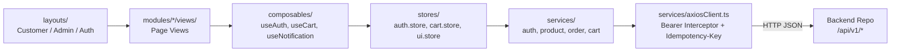

# Frontend Architecture (`frontend/docs/ARCHITECTURE.md`)

> Sơ đồ luồng dữ liệu một chiều chuẩn Enterprise Vue 3.5 + TypeScript (tương phản rõ cho cả Dark Mode & Light Mode).

## Edge Cases & Resilience Handled in Frontend
- **401 Token Expiry / Revocation Interceptor:** `axiosClient.ts` automatically clears stale session tokens and redirects cleanly to `/auth/login` on `401` responses.
- **Double-Click Checkout Guard:** Disables submit button while in-flight and attaches a deterministic UUID `Idempotency-Key` per checkout attempt so network retries never create duplicate orders.
- **API Offline Fallback Banner:** Displays clear actionable instructions if the independent Backend repository (`:8080`) has not been started yet.
